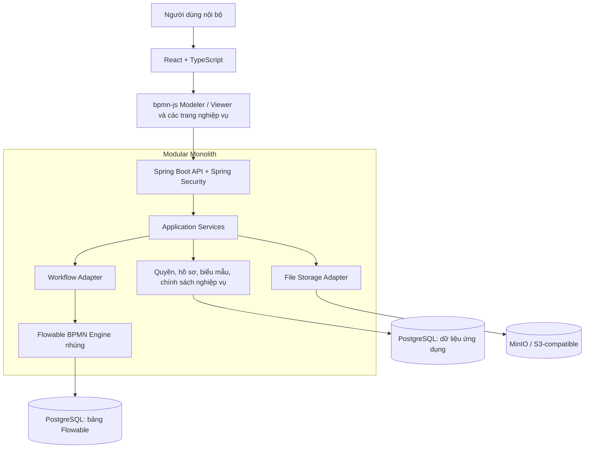

# Enterprise BPM — Đặc tả và tổng hợp quyết định MVP

**Sản phẩm:** Nền tảng quản lý quy trình nghiệp vụ cho một doanh nghiệp sử dụng nội bộ.
**Phiên bản tài liệu:** 1.2 — cập nhật quyết định môi trường phát triển ngày 01/11/2026.
**Ngày tổng hợp:** 30/10/2026.
**Trạng thái:** Tài liệu đặc tả để lập kế hoạch, thiết kế và nghiệm thu; chưa phải xác nhận hệ thống đã được xây dựng hoặc kiểm thử.

> **Quyết định công nghệ bắt buộc của MVP:** Frontend dùng **bpmn-js** để thiết kế và hiển thị BPMN; backend dùng **Java Spring Boot tích hợp Flowable BPMN Engine**. **Không dùng React Flow trong MVP.**

## 0. Nguồn tổng hợp và cách đọc

Tài liệu tổng hợp các lượt trao đổi truy xuất được từ cuộc trò chuyện [“Thảo luận dự án workflow”](chatgpt-conversation://6ae2fe3d-c7f4-83ec-a4f9-14a71d4667a7), kết hợp yêu cầu mới nhất của người dùng. Nguồn bao gồm lựa chọn mô hình một doanh nghiệp, đề xuất kiến trúc/phân quyền/dữ liệu, thảo luận engine của sản phẩm tham khảo, hướng UI, phương án React Flow từng được cân nhắc và quyết định quay lại bpmn-js cho MVP. Phần truy xuất không có tệp ảnh concept UI để đính kèm hoặc xem lại.

Để tránh biến một đề xuất trước đây thành quyết định đã được phê duyệt, tài liệu dùng ba mức:

| Mức | Ý nghĩa |
| --- | --- |
| **C — Đã chốt** | Người dùng đã lựa chọn rõ trong trao đổi hoặc yêu cầu hiện tại. |
| **B — Cơ sở đặc tả** | Phương án đã được đề xuất trong thảo luận và được hệ thống hóa ở đây để triển khai; chưa có bằng chứng người dùng duyệt riêng từng chi tiết. Các chi tiết bổ sung để đặc tả có thể kiểm thử được cũng thuộc mức này. |
| **O — Còn mở** | Cần quyết định nghiệp vụ/kỹ thuật tiếp; khuyến nghị trong tài liệu không có nghĩa là đã chốt. |

Các tên bảng, trạng thái, payload, mã lỗi và tiêu chí nghiệm thu chi tiết dưới đây là **thiết kế đề xuất**, trừ khi được ghi mức C. Những ví dụ về số tiền, thời hạn và dữ liệu nhân sự không phải chính sách thật của doanh nghiệp.

### Mục lục

1. Mục tiêu sản phẩm
2. Sổ quyết định và công nghệ
3. Phạm vi MVP và ngoài MVP
4. Trải nghiệm và các trang chính
5. Tổ chức, vai trò và phân quyền
6. Quy trình mẫu liên phòng ban
7. Kiến trúc hệ thống
8. Mô hình dữ liệu
9. Workflow Designer và Flowable Engine
10. API của MVP
11. Quy tắc nghiệp vụ
12. Versioning và vòng đời cấu hình
13. Audit, bảo mật và vận hành
14. Kiểm thử và acceptance criteria
15. Lộ trình triển khai
16. Các quyết định còn mở
17. Rủi ro và đối chiếu yêu cầu
18. Tài liệu kỹ thuật tham chiếu

## 1. Mục tiêu sản phẩm

### 1.1. Bài toán cần giải quyết

Doanh nghiệp cần một nền tảng thống nhất để tạo đề xuất, luân chuyển hồ sơ, phê duyệt và phối hợp giữa các phòng ban. Quy trình cần có thể cấu hình lại mà không phải viết một module phần mềm riêng cho từng loại đơn.

Các mục tiêu chính:

- Chuẩn hóa các bước xử lý, người chịu trách nhiệm, dữ liệu cần cung cấp và kết quả của từng bước.
- Cung cấp một nơi tập trung cho công việc được giao, công việc có thể nhận và hồ sơ đã gửi.
- Cho người tạo và người có quyền biết hồ sơ đang ở đâu, ai đang xử lý và vì sao bị trả lại hoặc từ chối.
- Giữ lịch sử xử lý có thể kiểm toán, kể cả khi quy trình được thay đổi ở các phiên bản sau.
- Tách cấu hình quy trình và biểu mẫu khỏi logic ứng dụng dùng chung.
- Tận dụng Flowable để điều phối BPMN thay vì tự phát triển workflow engine.

### 1.2. Mô hình sử dụng

**C:** Một doanh nghiệp sử dụng nội bộ, có nhiều phòng ban và nhóm chức năng. Không triển khai mô hình SaaS nhiều khách hàng trong MVP.

Một tổ chức vẫn cần phân quyền theo phòng ban, quy trình, hồ sơ, task và trường dữ liệu. Việc cùng thuộc một doanh nghiệp không tạo quyền xem toàn bộ dữ liệu.

### 1.3. Dấu hiệu MVP đạt mục tiêu

- Thiết kế, công bố và thực thi được quy trình mua sắm liên phòng ban.
- Tạo thêm được ít nhất một quy trình khác, ví dụ nghỉ phép hoặc cấp phát thiết bị, bằng cấu hình trong tập tính năng hỗ trợ.
- Các nhánh phê duyệt, từ chối và yêu cầu bổ sung chạy đúng, có lịch sử rõ ràng.
- Thay đổi cấu hình không làm thay đổi hồ sơ đang chạy trên phiên bản cũ.
- Phân quyền và xử lý đồng thời được kiểm tra bằng API, không phụ thuộc việc UI ẩn nút.

Người dùng đã xác nhận quy mô **50 nhân sự**, cao điểm khoảng **500 request/giây** (C-14). Đây là đầu vào/mục tiêu tải, chưa phải kết quả đã đo. Chi tiết workload, thời gian duy trì đỉnh và mục tiêu thời gian phản hồi được kỹ thuật hoàn thiện tại P8.5; không cần kéo dài thảo luận Phase 0 về tải. Không đồng nhất số nhân sự, số request/giây và số request đang xử lý đồng thời.

## 2. Sổ quyết định và công nghệ

### 2.1. Quyết định đã chốt

| Mã | Quyết định | Hệ quả |
| --- | --- | --- |
| C-01 | Một doanh nghiệp sử dụng nội bộ | Không làm tenant onboarding, tenant billing hoặc tenant isolation cho nhiều khách hàng trong MVP. |
| C-02 | Workflow Designer dùng **bpmn-js** | Thiết kế trên BPMN 2.0; lưu và tải lại BPMN XML; không cài React Flow để làm designer MVP. |
| C-03 | Workflow engine là **Flowable BPMN Engine** | Tái sử dụng process definition, instance, task và execution history của engine. |
| C-04 | Backend dùng **Java Spring Boot** | Tầng API/nghiệp vụ kiểm soát mọi thao tác với engine. |
| C-05 | Hai quy trình nghiệm thu là **mua sắm** và **nghỉ phép đơn giản** | Mua sắm là luồng chính; nghỉ phép chứng minh tái sử dụng bằng cấu hình, chưa tính số dư phép. Người dùng xác nhận tại thảo luận Phase 0 ngày 30/10/2026. |
| C-06 | **Một Admin thiết kế quy trình**; nhân viên trong công ty sử dụng | Quyền thiết kế quy trình tập trung ở Admin phụ trách; nhân viên tạo và xử lý hồ sơ theo quyền, không thiết kế quy trình. Quyền công bố, giám sát và xử lý ngoại lệ đã chốt tại C-09/mục 5.7. |
| C-07 | Giữ các hạng mục đã đề xuất hoãn ngoài MVP và pilot | Hoãn duyệt song song/hội đồng, SSO, ERP/HRM, email, chữ ký số, mobile native, báo cáo nâng cao và migration instance đang chạy. Người dùng xác nhận không có hạng mục nào trong danh sách này bắt buộc ngay khi pilot. |
| C-08 | Luồng và chính sách mua sắm tại mục 6.5 được xác nhận | Trưởng phòng → kế toán → giám đốc nếu tổng tiền đạt ngưỡng → mua hàng; VND nguyên đồng; bổ sung duyệt lại từ trưởng phòng; từ chối kết thúc; nhận đủ hàng và có chứng từ mới hoàn tất. Ngưỡng 50.000.000 VND theo C-13; self-approval theo C-09. |
| C-09 | Quyền và giao việc tại mục 5.7 được xác nhận | Admin thiết kế/công bố, xem toàn bộ hồ sơ/lịch sử và phân công lại có lý do; nhân viên xem hồ sơ của mình/từng trực tiếp xử lý. Giao trực tiếp + queue/claim; không tự duyệt. Hoãn ủy quyền tự phục vụ, trưởng phòng chia việc, unclaim và thu hồi/hủy/mở lại sau khi gửi. |
| C-10 | Biểu mẫu và phiên bản tại mục 5.8 được xác nhận | Một form chung chia nhóm, quyền trường theo bước, tập trường cơ bản; nháp được thiếu dữ liệu; published bất biến và hồ sơ chạy giữ version/ngưỡng cũ. Giữ nháp cũ khi chuyển bản; hoãn bảng nhiều dòng, công thức tùy ý, nguồn dữ liệu ngoài và bố cục phức tạp. |
| C-11 | Chính sách nền và mục tiêu vận hành tại mục 13.4 được xác nhận | Session server, timeout không hoạt động 30 phút; tài khoản do Admin quản lý; thông báo trong ứng dụng; deadline ngày lịch/UTC+7; giới hạn tệp/bình luận; không tự xóa dữ liệu. Backup hằng ngày, mục tiêu RPO 24 giờ/RTO 4 giờ cần kiểm chứng. Quy mô/tải theo C-14; hạ tầng và thời hạn lưu giữ cụ thể hoàn thiện theo mốc vận hành. |
| C-12 | Bản đồ màn hình và kế hoạch nghiệm thu P0.6 được xác nhận | UI tiếng Việt, ưu tiên desktop/laptop, một trang chi tiết theo quyền, inbox hai tab, trạng thái lỗi/conflict/hết phiên rõ ràng; Admin có thêm khu vực quản trị. [Bản đồ UI và acceptance matrix](Enterprise-BPM-Phase-0-UX-Acceptance.md) là đầu vào triển khai, không phải kết quả test đã đạt. |
| C-13 | Ngưỡng qua giám đốc là **50.000.000 VND** | Mẫu mua sắm dùng `amount >= 50000000`; bằng ngưỡng phải qua giám đốc. Ngưỡng thuộc version quy trình, thay đổi không tác động hồ sơ đang chạy. Người dùng xác nhận ngày 30/10/2026. |
| C-14 | Quy mô nhỏ, **50 nhân sự**, cao điểm khoảng **500 request/giây** | Ghi nhận làm đầu vào/mục tiêu kiểm thử P8.5. Theo yêu cầu người dùng, không cần thảo luận sâu thêm về tải ở Phase 0; kỹ thuật hoàn thiện workload và tiêu chí đo trước khi chạy tải. Không coi đây là năng lực đã được chứng minh. |
| C-15 | Bộ Java/Spring Boot/Flowable giữ nguyên theo `pom.xml`, đã được người dùng kiểm thử | Java 25, Spring Boot 4.1.2, Flowable 8.0.0. Người dùng xác nhận ngày 01/11/2026, không yêu cầu kiểm chứng lại tương thích. Kiểm thử nghiệp vụ, transaction và concurrency vẫn thuộc các bước tương ứng. |
| C-16 | Project chạy trong Docker để cô lập môi trường | Backend và PostgreSQL chạy bằng Docker Compose; cấu hình mạng, dữ liệu và môi trường test được tách rõ. Storage bổ sung theo mốc triển khai tệp. |
| C-17 | Giai đoạn dev chưa dùng database migration | Không đưa Flyway/Liquibase hoặc viết migration thành đầu việc bắt buộc khi dev. Cấu hình cơ chế quản lý schema dev/test và cách dựng lại dữ liệu; chính sách thay đổi schema trước pilot/production được xử lý ở mốc vận hành. Quyết định này khác với migration instance quy trình. |

### 2.2. Cơ sở đặc tả từ thảo luận

| Mã | Thành phần | Phương án cơ sở |
| --- | --- | --- |
| B-01 | Frontend | React + TypeScript. |
| B-02 | Java | Java 25 là baseline đã được đề xuất; kiểm tra lại với cặp phiên bản Spring Boot/Flowable được chọn. |
| B-03 | Kiến trúc | Modular Monolith; Flowable nhúng trong cùng ứng dụng Spring Boot. |
| B-04 | Database | PostgreSQL cho dữ liệu ứng dụng và dữ liệu engine. |
| B-05 | File storage | MinIO hoặc dịch vụ tương thích S3; không lưu nội dung file lớn trong process variables. |
| B-06 | Biểu mẫu | JSON Schema có mở rộng cho bố cục, trường hiển thị và quyền theo bước. |
| B-07 | Authentication | Spring Security; session server và vòng đời tài khoản đã chốt tại C-11/mục 13.4; SSO hoãn theo C-07. |
| B-08 | Authorization | RBAC kết hợp cơ cấu tổ chức, phạm vi hồ sơ/task và quyền theo trường. |
| B-09 | Transaction | Dữ liệu nghiệp vụ và Flowable dùng cùng datasource/transaction manager phù hợp để commit hoặc rollback cùng nhau. |
| B-10 | Phiên bản | Bản đã công bố bất biến; hồ sơ gắn với phiên bản quy trình và biểu mẫu cụ thể. |
| B-11 | Phân công | Bốn chiến lược ban đầu: người cụ thể, phòng ban, vai trò, trưởng phòng của người đề xuất. |
| B-12 | Mô hình thực thi | BPMN XML là định nghĩa thực thi; JSON metadata chỉ bổ sung cấu hình ứng dụng, không trở thành engine thứ hai. |

### 2.3. Phương án cũ được thay thế

Thảo luận từng đề xuất React Flow, custom nodes, Workflow DSL dạng JSON, compiler JSON → BPMN, Dagre/ELK và Guided/Hybrid Builder. **Các phần đó không thuộc phạm vi MVP hiện tại.** Không cần xây `WorkflowCompiler`, `NodeCompiler`, `ApprovalNodeCompiler` hay một graph JSON riêng chỉ để thay bpmn-js.

Các nguyên tắc vẫn giữ giá trị: kiểm tra cấu trúc/nghiệp vụ trước publish, kiểm soát điều kiện và phân công, bất biến phiên bản, xem tiến trình cùng sơ đồ, và dùng ngôn ngữ nghiệp vụ dễ hiểu. Với bpmn-js, “bước phê duyệt” được thể hiện bằng **User Task + Exclusive Gateway** theo BPMN, có thể có mẫu thao tác giúp tạo nhanh.

### 2.4. Bộ phiên bản backend đã xác nhận và thư viện còn chọn

**C-15 — cập nhật 01/11/2026:** Người dùng xác nhận Java 25/Spring Boot 4.1.2/Flowable 8.0.0 đúng như `pom.xml` đã được kiểm thử. Giữ nguyên bộ này, không lập lại bước kiểm chứng tương thích. Đây là kết quả do người dùng cung cấp; việc chuẩn bị môi trường Docker và kiểm thử nghiệp vụ/transaction tiếp tục theo kế hoạch.

**O-01 còn lại:** Chọn và khóa frontend, bpmn-js và JSON Schema validator trước khi tích hợp thành phần tương ứng; không mở lại lựa chọn backend đã chốt.

## 3. Phạm vi MVP và ngoài MVP

### 3.1. Phạm vi MVP — cơ sở đặc tả

**Cập nhật Phase 0 ngày 30/10/2026:** C-05–C-14 xác nhận chính sách và trải nghiệm của cả sáu nhóm P0.1–P0.6, ngưỡng mua sắm 50.000.000 VND và quy mô 50 nhân sự/cao điểm khoảng 500 request/giây. Bản đồ UI và kế hoạch nghiệm thu tại [UI/acceptance](Enterprise-BPM-Phase-0-UX-Acceptance.md). Phần thảo luận phạm vi/nghiệp vụ/trải nghiệm đã chốt; các đầu ra kỹ thuật, hạ tầng, lưu giữ và workload tiếp tục hoàn thiện theo mốc phụ thuộc. Không coi xác nhận đầu vào là tính năng đã triển khai hoặc kiểm thử đạt.

| Nhóm | Khả năng tối thiểu |
| --- | --- |
| Danh tính | Đăng nhập, đăng xuất, quản lý tài khoản, trạng thái ACTIVE/INACTIVE và quyền hệ thống. |
| Tổ chức | Phòng ban dạng cây, thành viên, phòng ban chính, chức danh và trưởng phòng. |
| Quy trình | Danh mục quy trình, Process Owner, tạo/sửa nháp, validate, publish, xem phiên bản, ngừng cho khởi tạo phiên bản cũ. |
| Designer | bpmn-js với palette giới hạn, property panel nghiệp vụ, lưu/tải lại BPMN XML và bố cục. |
| Biểu mẫu | Một form chung chia nhóm; văn bản ngắn/dài, số nguyên/thập phân, tiền VND, ngày, chọn một/nhiều, checkbox và tệp; validation/quyền theo bước theo C-10/mục 5.8. |
| Hồ sơ | Lưu nháp trước khi gửi, nộp hồ sơ, xem chi tiết, bình luận, tệp đính kèm và lịch sử. Lưu nháp là phần bổ sung đặc tả để làm rõ vòng đời tạo hồ sơ. |
| Task | Việc của tôi, việc có thể nhận, claim, xem dữ liệu cần thiết và thực hiện hành động hợp lệ. |
| Phê duyệt | APPROVE, REJECT, REQUEST_CHANGES; RESUBMIT cho bước bổ sung; COMPLETE cho bước thực hiện. |
| Điều phối | Tuần tự, rẽ nhánh XOR, vòng bổ sung đã định nghĩa trong BPMN, kết thúc thành công hoặc từ chối. |
| Phân công | Giao trực tiếp hoặc candidate queue theo cấu hình; hàng chờ ngoại lệ khi không xác định được người xử lý. Chính sách đầy đủ xem O-02. |
| Theo dõi | Danh sách có lọc theo quyền, timeline và sơ đồ chỉ đọc của đúng phiên bản đang chạy. |
| Hạn xử lý | Giờ/ngày lịch từ lúc tạo task, gồm cuối tuần; hiển thị UTC+7; phân công lại không reset hạn. Đánh dấu/lọc quá hạn, không tự duyệt/chuyển cấp/kết thúc. C-11/mục 13.4. |
| Thông báo | Thông báo trong ứng dụng cho task mới, yêu cầu bổ sung, từ chối và hoàn tất; email hoãn theo C-07. |
| Kiểm soát | Authorization phía server, validation, audit, chống xử lý lặp và concurrency. |
| Vận hành | Log lỗi, theo dõi ngoại lệ phân công, backup/restore database và file; kiểm tra phục hồi trước sử dụng thật. |

### 3.2. Ngoài MVP

- SaaS multi-tenant, billing, marketplace quy trình.
- **React Flow**, Workflow DSL riêng và compiler JSON → BPMN; hai designer song song hoặc Guided Builder đầy đủ.
- Tự phát triển workflow engine hoặc tách engine thành một microservice độc lập.
- Parallel/Inclusive/Event-based Gateway, multi-instance voting/quorum, dynamic subprocess và call activity.
- DMN, CMMN, mô phỏng quy trình, process mining và báo cáo BI nâng cao.
- Timer/boundary event cho escalation phức tạp; deadline hiển thị cơ bản không đồng nghĩa có BPMN timer.
- Designer cho Service Task, Script Task, HTTP Request hoặc thực thi mã tùy ý.
- Di chuyển instance đang chạy sang phiên bản mới; chuyển execution đến một bước tùy chọn.
- AI tạo quy trình, OCR và xử lý tài liệu thông minh.
- SSO/LDAP/Active Directory và tích hợp ERP/HRM qua webhook/external trigger, trừ khi doanh nghiệp bổ sung thành điều kiện bắt buộc.
- Import/chỉnh XML tự do và cam kết hỗ trợ toàn bộ BPMN 2.0 từ công cụ bên ngoài.
- Ứng dụng mobile native, cổng người dùng bên ngoài doanh nghiệp và chữ ký số chuyên dụng.

**Không đưa ra khỏi MVP:** phân quyền backend, lịch sử/audit, versioning, kiểm thử concurrent claim/complete, backup và khôi phục dữ liệu.

## 4. Trải nghiệm và các trang chính

### 4.1. Định hướng giao diện

Người dùng muốn tham khảo trải nghiệm của **MISA AMIS Quy trình** và **Base.vn**: rõ người phụ trách, trạng thái, bước tiếp theo và hành động nghiệp vụ. Đây là định hướng UX; không có quyết định sao chép giao diện hay toàn bộ tính năng của các sản phẩm đó.

Cuộc thảo luận chưa xác định được engine nội bộ của Base/MISA bằng bằng chứng đáng tin cậy. Tài liệu này không khẳng định họ dùng Flowable hoặc engine tự xây. Lựa chọn Flowable của dự án dựa trên nhu cầu của chính dự án.

### 4.2. Các trang/khối chức năng

**C-12:** Bản đồ màn hình, route/điều hướng, trải nghiệm theo vai trò và trạng thái UI đã được người dùng xác nhận tại [UI và nghiệm thu Phase 0](Enterprise-BPM-Phase-0-UX-Acceptance.md). Mô hình sử dụng chính thức là một Admin thiết kế/quản trị và nhân viên sử dụng; các năng lực Designer/Owner/Auditor trong thiết kế cơ sở không mặc nhiên thêm nhóm người dùng bắt buộc.

| Trang | Nội dung và thao tác chính |
| --- | --- |
| Tổng quan | Việc cần làm, hồ sơ đã gửi, hồ sơ cần bổ sung và task quá hạn trong phạm vi được xem. |
| Danh mục quy trình | Tìm quy trình được phép khởi tạo; xem mô tả và phiên bản đang được áp dụng. |
| Thiết kế quy trình | Palette bên trái, canvas bpmn-js ở giữa, thuộc tính bên phải; Lưu nháp, Kiểm tra, Công bố theo quyền. |
| Thiết kế biểu mẫu | Cấu hình trường, validation, bố cục và quyền theo bước; quản lý phiên bản form. |
| Công việc của tôi | Task đã giao/đã claim, lọc trạng thái/hạn xử lý; mở màn hình xử lý. |
| Công việc có thể nhận | Candidate queue được phép xem và nhận; không hiển thị các phòng ban ngoài phạm vi. |
| Hồ sơ của tôi | Nháp, đã gửi, đang xử lý, cần bổ sung, hoàn tất, bị từ chối. |
| Chi tiết hồ sơ/task | Dữ liệu theo quyền, tệp, bình luận, timeline, sơ đồ tiến trình và nút hành động hợp lệ. |
| Quản lý quy trình | Process Owner xem hồ sơ của quy trình được giao và các ngoại lệ cần xử lý. |
| Quản trị | Nhân sự, phòng ban, vai trò, quyền và cấu hình hệ thống. |
| Kiểm toán | Tìm lịch sử và audit theo phạm vi đã cấp, không có thao tác sửa kết quả xử lý. |

### 4.3. Tùy biến bpmn-js cho MVP

bpmn-js cung cấp modeler/viewer và khả năng mở rộng palette, rules, rendering; không phải workflow engine. Dùng modeler ở trang thiết kế và viewer ở trang theo dõi. [Nguồn: bpmn-js walkthrough](https://bpmn.io/toolkit/bpmn-js/walkthrough/).

Cơ sở thiết kế:

- Làm đẹp khung trang, thanh công cụ, typography, trạng thái và property panel.
- Chỉ hiện tập BPMN elements của MVP; ẩn các công cụ không được hỗ trợ.
- Hiển thị tên bước bằng tiếng Việt và nhãn “Người xử lý”, “Biểu mẫu”, “Hành động”, “Hạn xử lý”.
- Giữ ngữ nghĩa và ký hiệu BPMN đủ rõ để kiểm tra mô hình, tránh thay toàn bộ canvas bằng giao diện node card mới.
- Viewer dùng activity/task identifiers để tô trạng thái từ backend; timeline phân biệt các lần lặp cùng một bước.
- Lỗi validate phải trỏ về element ID/tên bước tương ứng.
- Không có nút cho nhân viên thông thường sửa sơ đồ đang thực thi.

## 5. Tổ chức, vai trò và phân quyền

### 5.1. Cơ cấu tổ chức

```text
Một doanh nghiệp
  └── Phòng ban (có thể có phòng ban cha)
       ├── Trưởng phòng
       └── Thành viên

Người dùng
  ├── Phòng ban chính
  ├── Chức danh/vị trí
  ├── Vai trò hệ thống
  └── Quyền theo quy trình/hồ sơ/task
```

- Người dùng có trạng thái `ACTIVE` hoặc `INACTIVE`; inactive không được đăng nhập/nhận hoặc hoàn thành task mới.
- MVP dùng một phòng ban chính cho việc xác định trưởng phòng; hỗ trợ nhiều phòng ban đồng thời là mở rộng sau.
- Danh tính được tham chiếu bằng ID ổn định, không dùng tên hiển thị làm khóa phân công.
- Không xóa cứng người/phòng ban đã xuất hiện trong lịch sử; thay đổi trạng thái và giữ tham chiếu kiểm toán.
- Hoãn ủy quyền tự phục vụ trong MVP. Admin xử lý người thay thế bằng phân công lại có kiểm soát theo C-09/mục 5.7.

### 5.2. Vai trò

**Mô hình sử dụng đã chốt (C-06/C-09):** Một Admin thiết kế và công bố quy trình/biểu mẫu; nhân viên sử dụng các quy trình được cung cấp. Workflow Designer trong bảng dưới là nhóm năng lực do Admin đảm nhiệm trong MVP. Process Owner/Auditor mô tả các năng lực và phạm vi trong thiết kế cơ sở, không bổ sung quyền cho nhân viên vượt mô hình đã chốt tại mục 5.7. Quyền quản trị không tự cấp quyền duyệt task.

| Vai trò | Trách nhiệm | Giới hạn |
| --- | --- | --- |
| System Admin | Tài khoản, tổ chức, quyền, thiết kế/công bố cấu hình, xem toàn bộ hồ sơ/lịch sử và xử lý ngoại lệ phân công. | Chỉ duyệt khi được giao hợp lệ, đủ quyền nghiệp vụ và không tự duyệt hồ sơ do mình tạo. |
| Workflow Designer | Tạo/sửa bản nháp quy trình, biểu mẫu và cấu hình bước. | Không mặc nhiên có quyền publish hoặc xem tất cả hồ sơ sử dụng quy trình. |
| Process Owner | Chịu trách nhiệm một hoặc nhiều quy trình; giám sát, quản lý cấu hình và publish nếu được cấp quyền. | Phạm vi gắn với quy trình được giao; không tự vượt quyền task. |
| Employee/Requester | Tạo hồ sơ, theo dõi hồ sơ của mình, bổ sung dữ liệu và thực hiện task được giao. | Chỉ chỉnh sửa các trường và trạng thái được cho phép. |
| Approver | Phê duyệt, từ chối, yêu cầu bổ sung tại bước được phân công. | Là năng lực/ngữ cảnh xử lý; có thể cấp cho Employee hoặc quản lý, không phải quyền duyệt mọi hồ sơ. |
| Auditor | Xem hồ sơ, lịch sử và audit trong phạm vi được cấp. | Chỉ đọc; không claim, hoàn thành hoặc sửa dữ liệu qua quyền auditor. |

Một người có thể có nhiều vai trò. Vai trò hệ thống, chức danh và người xử lý của một task là ba khái niệm khác nhau.

### 5.3. Ba lớp kiểm tra quyền

1. **RBAC:** Có quyền dùng chức năng, ví dụ `process.design`, `process.publish`, `record.create`, `task.claim`, `task.complete`, `audit.read`.
2. **Tổ chức/phạm vi dữ liệu:** Có thuộc phòng ban, quy trình hoặc phạm vi hồ sơ được phép truy cập không.
3. **Hồ sơ/task và trạng thái:** Có là requester, assignee, candidate hợp lệ, Process Owner hoặc người được cấp quyền rõ ràng không; task/hồ sơ có đang ở trạng thái cho phép không.

```text
Cho phép hoàn thành task =
  Tài khoản đang hoạt động
  AND Có quyền chức năng
  AND Có quyền trên hồ sơ/phạm vi dữ liệu
  AND Là assignee hiện tại hoặc đã claim hợp lệ
  AND Task đang hoạt động
  AND Action được cấu hình cho bước
  AND Payload chỉ sửa các trường được cấp quyền
```

Áp dụng **deny by default**. Backend kiểm tra lại ở mỗi request; JWT role hoặc việc UI hiện nút không đủ để cấp quyền.

### 5.4. Ma trận quyền cơ sở

| Hành động | Admin | Designer | Process Owner | Employee/Approver | Auditor |
| --- | --- | --- | --- | --- | --- |
| Quản lý người dùng/phòng ban | Theo quyền quản trị | Không | Không | Không | Không |
| Sửa quy trình/form nháp | Admin phụ trách thiết kế | Năng lực do Admin đảm nhiệm trong MVP | Không cấp riêng trong mô hình MVP đã chốt | Không | Không |
| Publish | Admin tự công bố, không cần phê chuẩn riêng | Năng lực do Admin đảm nhiệm trong MVP | Không cấp riêng trong mô hình MVP đã chốt | Không | Không |
| Khởi tạo hồ sơ | Khi được cấp quyền khởi tạo | Khi được cấp quyền khởi tạo | Khi được cấp quyền khởi tạo | Quy trình được phép | Không qua quyền auditor |
| Xem hồ sơ | Toàn bộ hồ sơ và lịch sử | Theo quyền Admin trong MVP | Không tự mở rộng quyền nhân viên | Hồ sơ của mình hoặc từng trực tiếp xử lý; candidate xem đủ dữ liệu nhận việc trong phạm vi queue | Phạm vi kiểm toán được cấp |
| Claim task | Chỉ khi là candidate hợp lệ | Tương tự | Tương tự | Candidate hợp lệ | Không |
| Hoàn thành/duyệt | Chỉ khi có quyền task nghiệp vụ | Tương tự | Tương tự | Assignee hợp lệ | Không |
| Phân công lại | Cho người đủ thẩm quyền; bắt buộc lý do và audit | Theo quyền Admin trong MVP | Không cấp riêng trong mô hình MVP đã chốt | Không | Không |
| Đọc audit | Theo quyền và phạm vi | Không mặc định | Theo quyền và phạm vi | Lịch sử hồ sơ được phép | Theo phạm vi kiểm toán |

### 5.5. Phân công task

| Chiến lược | Cách xác định |
| --- | --- |
| `SPECIFIC_USER` | Một user ID đã cấu hình và đang hoạt động. |
| `DEPARTMENT` | Candidate queue của phòng ban; thành viên đủ quyền tự nhận trước khi xử lý. |
| `ROLE` | Candidate queue theo vai trò nghiệp vụ và phạm vi cấu hình; phải claim trước khi xử lý, không gom vai trò trên toàn doanh nghiệp. |
| `REQUESTER_MANAGER` | Giao trực tiếp cho trưởng phòng được resolve khi tạo task, dựa trên phòng ban requester đã giữ tại lúc gửi. |

Flowable có khái niệm assignee, candidate users và candidate groups; ứng dụng vẫn chịu trách nhiệm xác thực người dùng và thành viên nhóm. [Nguồn: Flowable task assignment](https://www.flowable.com/open-source/docs/bpmn/ch07b-BPMN-Constructs/#user-assignment).

**C-09:** Dùng giao trực tiếp và hàng chờ tự nhận. Admin được phân công lại có kiểm soát; hoãn trưởng phòng chia việc, ủy quyền tự phục vụ và tự trả task về hàng chờ. Chính sách đầy đủ tại mục 5.7.

Khi không tìm được người xử lý hợp lệ, phải giữ bước chờ trong **hàng chờ ngoại lệ được bảo vệ**, báo cho người có quyền và ghi lý do. Không bỏ qua bước, tự approve hoặc cho toàn doanh nghiệp claim. Cách hiển thị/trạng thái nội bộ của hàng chờ là chi tiết cần thiết kế.

### 5.6. Quyền theo trường và tệp

- Quyền trường đã chốt: `HIDDEN`, `READ_ONLY`, `EDITABLE`; validation bắt buộc tùy bước/action theo C-10/mục 5.8.
- Server áp dụng danh sách trường cho phép; gửi thêm trường không được quyền phải bị từ chối, không âm thầm ghi vào JSONB.
- Ví dụ kế toán được cập nhật `budgetCode`, `budgetApproved`; không mặc nhiên được thay đổi `amount` do requester khai báo.
- Quyền tải tệp và đọc bình luận gắn với quyền hồ sơ, không dựa vào việc biết URL hoặc attachment ID.
- Quyền tải BPMN XML cần xét metadata có thể nhạy cảm; nhân viên chỉ cần viewer không mặc nhiên được tải toàn bộ cấu hình quản trị.

### 5.7. Quyền và giao việc đã xác nhận tại P0.3

Người dùng xác nhận toàn bộ đề xuất quyền/giao việc trong thảo luận Phase 0 ngày 30/10/2026 (C-09):

| Nội dung | Quy tắc đã chốt |
| --- | --- |
| Thiết kế/công bố | Một Admin tạo/sửa quy trình, biểu mẫu và tự công bố; chưa cần người phê chuẩn riêng. |
| Xem/giám sát | Admin xem toàn bộ hồ sơ và lịch sử để vận hành. Nhân viên xem hồ sơ của mình và hồ sơ từng trực tiếp xử lý; không tự có quyền xem toàn phòng ban. Quyền trường đã chốt tại C-10/mục 5.8; quyền xem không tự cấp quyền sửa. |
| Giao trực tiếp | Trưởng phòng, giám đốc và người cụ thể được giao trực tiếp khi task được tạo. |
| Giao nhóm | Kế toán/mua hàng dùng queue phòng ban; một người phải nhận việc trước khi xử lý. Queue theo vai trò cũng phải giới hạn phạm vi. |
| Self-approval | Không duyệt hồ sơ do mình tạo. Chuyển người có thẩm quyền thay thế; chưa xác định được thì giữ chờ và báo Admin, không tự bỏ qua bước. |
| Thay đổi nhân sự | Giữ phòng ban requester tại thời điểm gửi. Resolve người xử lý khi tạo task; task đã giao không tự chuyển khi đổi trưởng phòng. |
| Ngoại lệ/phân công lại | Admin chọn người đủ thẩm quyền, bắt buộc lý do và lịch sử người cũ/mới. Admin chỉ duyệt khi được giao hợp lệ, đủ quyền nghiệp vụ và đáp ứng quy tắc không tự duyệt. |
| Hoãn | Ủy quyền tự phục vụ, trưởng phòng chia việc, tự trả task về queue (unclaim). Khi cần, Admin dùng phân công lại. |
| Thu hồi/hủy/mở lại | Requester được xóa hồ sơ nháp của mình; sau khi gửi không hỗ trợ thu hồi, hủy hoặc mở lại trong MVP. |

Các trường hợp thiếu trưởng phòng, assignee inactive hoặc self-approval không có người thay thế phải xuất hiện trong hàng chờ ngoại lệ của Admin. Không tự cấp quyền phê duyệt cho Admin chỉ vì có quyền xử lý ngoại lệ.

### 5.8. Biểu mẫu và phiên bản đã xác nhận tại P0.4

Người dùng xác nhận phương án biểu mẫu/version trong thảo luận Phase 0 ngày 30/10/2026 (C-10):

| Nội dung | Quy tắc đã chốt |
| --- | --- |
| Cấu trúc/thiết kế | Mỗi quy trình dùng một biểu mẫu chung chia nhóm thông tin. Admin thêm trường, đặt nhãn, sắp xếp nhóm, cấu hình bắt buộc và quyền theo bước. |
| Loại trường MVP | Văn bản ngắn/dài, số nguyên, số thập phân, tiền VND nguyên đồng, ngày, chọn một/nhiều, checkbox và tham chiếu tệp đính kèm. |
| Quyền trường | Ẩn / Chỉ xem / Được sửa; backend kiểm tra trước khi lưu. Admin xem toàn bộ nhưng không sửa tùy ý dữ liệu hồ sơ đã gửi. |
| Validation theo action | Lưu nháp được thiếu dữ liệu. Gửi/hoàn thành bước kiểm tra trường bắt buộc tương ứng. Từ chối/trả bổ sung chỉ bắt buộc lý do, không buộc điền đủ dữ liệu để approve/complete; vẫn kiểm tra kiểu dữ liệu, quyền và tính hợp lệ của payload được gửi. |
| Published/version pinning | Không sửa bản đã công bố. Thay đổi tạo bản mới; hồ sơ đang chạy giữ quy trình, form và ngưỡng duyệt cũ. |
| Nháp có version ngừng dùng | Giữ nguyên nháp cũ; hỗ trợ tạo nháp theo bản hợp lệ và sao chép trường còn tương thích. Người dùng kiểm tra trước khi gửi; không tự thay schema hoặc làm mất nháp nguồn. |
| Hoãn | Bảng nhiều dòng lặp, công thức tính tùy ý, dữ liệu từ hệ thống ngoài và bố cục phức tạp. Mẫu mua sắm MVP chưa có bảng kê nhiều mặt hàng riêng biệt. |

**Quyền cập nhật của mẫu mua sắm:**

| Nhóm trường | Nháp/bổ sung của requester | Trưởng phòng/giám đốc | Kế toán | Mua hàng | Admin giám sát |
| --- | --- | --- | --- | --- | --- |
| Tên hàng, số lượng, tổng tiền, lý do, tài liệu đề xuất | EDITABLE | READ_ONLY | READ_ONLY | READ_ONLY | READ_ONLY |
| Mã ngân sách, xác nhận đủ ngân sách | READ_ONLY | READ_ONLY | EDITABLE tại bước kiểm tra ngân sách | READ_ONLY | READ_ONLY |
| Thông tin hoàn thành/chứng từ nhận hàng | READ_ONLY | READ_ONLY | READ_ONLY | EDITABLE tại bước thực hiện | READ_ONLY |
| Người tạo, phòng ban, trạng thái, thời gian, lịch sử | READ_ONLY; hệ thống ghi | READ_ONLY | READ_ONLY | READ_ONLY | READ_ONLY |

Ma trận trên chỉ áp dụng sau khi actor có quyền truy cập hồ sơ/task. Ngoài nháp hoặc task bổ sung đang được giao, requester chỉ được đọc; quyền sửa kết thúc khi task hoàn thành. Mỗi lần bổ sung vẫn phải kiểm tra lại ngân sách theo vòng duyệt mới, không cho requester sửa kết quả kế toán. Bộ máy quyền hỗ trợ HIDDEN cho cấu hình khác; mẫu mua sắm chưa yêu cầu nhóm trường bí mật riêng.

Field ID, hợp đồng schema/UI schema, form binding và ma trận validation chi tiết là đầu ra thiết kế cần hoàn thiện trước P3/P4. Schema dialect và thư viện validator còn phải lựa chọn/kiểm chứng theo O-01/O-08; không coi xác nhận chính sách sản phẩm là xác nhận phiên bản thư viện.

## 6. Quy trình mẫu: Đề xuất mua sắm liên phòng ban

### 6.1. Mục đích và giới hạn của ví dụ

Quy trình mua sắm là luồng nghiệm thu chính đã chốt. Người dùng xác nhận thứ tự/chính sách tại C-08, self-approval/giao việc tại C-09 và ngưỡng **50.000.000 VND** tại C-13 trong thảo luận Phase 0 ngày 30/10/2026. Các số tiền hồ sơ trong ví dụ vẫn là dữ liệu minh họa; ngưỡng đã chốt được áp dụng qua cấu hình version.

### 6.2. Dữ liệu mẫu

| Trường | Ý nghĩa | Người cập nhật theo mẫu |
| --- | --- | --- |
| `deviceName` | Hàng hóa/thiết bị đề xuất | Requester ở nháp hoặc bước bổ sung. |
| `quantity` | Số lượng, lớn hơn 0 | Requester. |
| `amount` | Tổng tiền đề xuất, không âm, có quy ước đơn vị tiền | Requester; khóa ở các bước duyệt. |
| `reason` | Lý do mua sắm | Requester. |
| `attachments` | Tham chiếu báo giá/tài liệu | Người có quyền tải lên ở bước tương ứng. |
| `budgetCode` | Mã ngân sách | Kế toán. |
| `budgetApproved` | Kết quả kiểm tra ngân sách | Kế toán. |

Requester, phòng ban requester, business key, process/form version và trạng thái là dữ liệu hệ thống xác định; client không được tự gán để thay đổi quyền.

```json
{
  "deviceName": "Laptop Dell",
  "quantity": 5,
  "amount": 75000000,
  "reason": "Trang bị thiết bị mới",
  "budgetCode": "IT-2026"
}
```

Số tiền trong ví dụ là dữ liệu minh họa, không chốt hạn mức phê duyệt. MVP đã chốt dùng VND nguyên đồng; backend phải dùng kiểu số chính xác và không chấp nhận phần lẻ đồng. Không hỗ trợ đa tiền tệ trong phạm vi mẫu đã thống nhất.

### 6.3. Luồng chính

```text
Nhân viên lưu nháp → Gửi đề xuất → Bắt đầu instance
    ↓
Trưởng phòng phê duyệt
    ├── REJECT → Kết thúc: REJECTED
    ├── REQUEST_CHANGES → Nhân viên bổ sung → RESUBMIT → Trưởng phòng duyệt lại
    └── APPROVE
          ↓
Kế toán kiểm tra ngân sách
    ├── REJECT → Kết thúc: REJECTED
    ├── REQUEST_CHANGES → Nhân viên bổ sung → RESUBMIT → Trưởng phòng duyệt lại
    └── APPROVE
          ↓
Gateway: amount >= approvalThreshold ?
    ├── Có → Giám đốc phê duyệt
    │           ├── REJECT → Kết thúc: REJECTED
    │           ├── REQUEST_CHANGES → Bổ sung → RESUBMIT → Trưởng phòng duyệt lại
    │           └── APPROVE → Phòng mua hàng thực hiện
    └── Không → Phòng mua hàng thực hiện
                         ↓
                    COMPLETE
                         ↓
                  Kết thúc: COMPLETED
```

Các kết quả APPROVE/REJECT/REQUEST_CHANGES của mỗi User Task được điều hướng qua Exclusive Gateway trong BPMN, không phải ba nhánh không điều kiện đi trực tiếp từ task.

### 6.4. Cấu hình bước mẫu

| Bước | Assignment | Hành động | Điều kiện chính |
| --- | --- | --- | --- |
| Tạo đề xuất | Requester đã đăng nhập | SAVE_DRAFT, SUBMIT ở tầng hồ sơ | Dữ liệu đầu vào hợp lệ; có quyền khởi tạo. |
| Trưởng phòng duyệt | REQUESTER_MANAGER | APPROVE, REJECT, REQUEST_CHANGES | Chỉ xem dữ liệu và quyết định; không tự sửa số tiền. |
| Bổ sung | Giao cho requester của hồ sơ | RESUBMIT | Chỉ sửa trường được phép; ghi phiên sửa dữ liệu. |
| Kiểm tra ngân sách | DEPARTMENT kế toán | APPROVE, REJECT, REQUEST_CHANGES | Claim trước khi xử lý; `budgetApproved=true` khi approve theo mẫu. |
| Giám đốc duyệt | SPECIFIC_USER | APPROVE, REJECT, REQUEST_CHANGES | Giao trực tiếp; chỉ kích hoạt khi đạt ngưỡng cấu hình. |
| Thực hiện mua sắm | DEPARTMENT mua hàng | COMPLETE | Người đã nhận task xác nhận đã nhận đủ hàng và đính kèm chứng từ; chưa tách bước nghiệm thu riêng. |

Giao bước bổ sung về requester dùng ID đã được backend xác nhận của hồ sơ; không cho client tùy ý chọn một người nhận mới. Đây là binding hệ thống của mẫu quy trình, không tạo thêm cơ chế giao việc tùy ý.

### 6.5. Chính sách mua sắm đã xác nhận và phần còn mở

**Đã xác nhận (C-08):**

| Nội dung | Quy tắc |
| --- | --- |
| Thứ tự | Nhân viên gửi → trưởng phòng duyệt → kế toán kiểm tra ngân sách → giám đốc nếu đạt ngưỡng → mua hàng → hoàn tất. |
| Điều kiện qua giám đốc | `approvalThreshold = 50000000` VND; `amount >= approvalThreshold` phải qua giám đốc. Dưới ngưỡng đi từ kế toán sang mua hàng. C-13. |
| Tiền tệ | VND, số tiền nguyên đồng. |
| Bổ sung | Requester sửa tại bước bổ sung rồi gửi lại; duyệt lại từ trưởng phòng, tính lại nhánh ngưỡng theo dữ liệu mới. Kết quả kiểm tra ngân sách cũ không thay thế lần kiểm tra mới. |
| Từ chối | Bắt buộc lý do; kết thúc hồ sơ REJECTED. Muốn đề xuất lại phải tạo hồ sơ mới, không mở lại hồ sơ bị từ chối. |
| Yêu cầu bổ sung | Bắt buộc ghi rõ nội dung cần bổ sung. |
| Không đủ ngân sách | Kế toán yêu cầu điều chỉnh hoặc từ chối; không cho đi tiếp khi chưa xác nhận đủ ngân sách. |
| Hoàn tất | Mua hàng xác nhận đã nhận đủ hàng, kèm chứng từ. Chưa tách thêm bước nghiệm thu riêng. |

**Giá trị biên để nghiệm thu (C-13):**

| Tổng tiền đề xuất | Nhánh sau khi kế toán xác nhận đủ ngân sách |
| --- | --- |
| 49.999.999 VND | Sang mua hàng, không tạo task giám đốc. |
| 50.000.000 VND | Phải qua giám đốc. |
| 50.000.001 VND | Phải qua giám đốc. |

Bổ sung làm tổng tiền từ 49.999.999 lên 50.000.001 VND phải duyệt lại từ trưởng phòng, kiểm tra lại ngân sách và qua giám đốc. Không dùng ngưỡng hoặc kết quả duyệt mới nhất ngoài version của hồ sơ đang chạy.

Self-approval và giao việc đã chốt tại P0.3/C-09: không tự duyệt, chuyển người có thẩm quyền thay thế hoặc giữ chờ ngoại lệ để Admin xử lý; áp dụng bốn chiến lược tại mục 5.5.

### 6.6. Quy trình thứ hai để chứng minh tính tổng quát

**C-05:** Quy trình nghiệm thu thứ hai là nghỉ phép đơn giản, không tính số dư phép hoặc tích hợp HRM trong MVP. **B — cấu hình chi tiết đề xuất:** requester gửi → trưởng phòng duyệt → hoàn tất/từ chối hoặc yêu cầu bổ sung; biểu mẫu gồm loại nghỉ, ngày bắt đầu, ngày kết thúc và lý do.

Tiêu chí: tạo được quy trình và biểu mẫu bằng cùng nền tảng, không thêm một state machine, endpoint duyệt hoặc bảng runtime riêng cho nghỉ phép.

## 7. Kiến trúc hệ thống

### 7.1. Kiến trúc cơ sở



Hai khối PostgreSQL trong sơ đồ thể hiện hai nhóm bảng, có thể đặt trong cùng database và datasource. Sơ đồ không yêu cầu hai database hoặc hai service độc lập. Đường DOMAIN → database biểu thị lưu dữ liệu qua repository adapter; domain không truy cập trực tiếp database.

### 7.2. Phân chia trách nhiệm

| Tầng ứng dụng Spring Boot | Flowable Engine |
| --- | --- |
| Danh tính, phòng ban, vai trò, authorization | Definition và deployment BPMN. |
| Danh mục quy trình, bản nháp, quyền publish | Process instance và execution/token. |
| Form schema, quyền trường, dữ liệu hồ sơ | Task runtime, assignee/candidate links. |
| Chính sách phân công và xác thực hành động | Chuyển bước, đánh giá gateway theo mô hình đã triển khai. |
| Tệp, bình luận, thông báo, audit nghiệp vụ | Lịch sử thực thi được cấu hình lưu. |
| API và mô hình dữ liệu phục vụ UI | Các dịch vụ engine được gọi qua adapter nội bộ. |

Không để frontend gọi Flowable REST/admin trực tiếp. Không cho frontend tự hoàn thành task, gán assignee hoặc chuyển execution bằng một đường API bỏ qua application service.

### 7.3. Module backend đề xuất

```text
com.company.bpm
├── bootstrap
├── identity
├── organization
├── process
│   ├── definition
│   ├── deployment
│   └── execution
├── form
├── businessrecord
├── task
├── notification
├── audit
└── shared
```

Trong module có thể tách `domain`, `application`, `infrastructure` và lớp API phù hợp. Ưu tiên ranh giới trách nhiệm rõ; không tạo nhiều abstraction hoặc triển khai đầy đủ DDD khi chưa có nhu cầu.

- Controller nhận/trả DTO và gọi use case, không chứa chính sách phê duyệt.
- Application service đặt ranh giới transaction và phối hợp quyền, dữ liệu, audit, engine.
- Domain/policy xử lý quy tắc doanh nghiệp bằng kiểu dữ liệu của ứng dụng.
- Adapter che API/class của Flowable, repository và MinIO khỏi phần lõi nghiệp vụ.
- DTO công khai không phơi bày trực tiếp object nội bộ của engine.
- Tránh phụ thuộc vòng giữa các module; dùng dịch vụ hoặc sự kiện nội bộ có chủ sở hữu rõ ràng.

### 7.4. Ranh giới transaction

Luồng hoàn thành task cơ sở:

```text
Xác thực
  → Kiểm tra phạm vi và quyền
  → Bắt đầu transaction ứng dụng
  → Đọc lại task/hồ sơ hiện tại và kiểm tra concurrency
  → Validate action, field permissions và dữ liệu
  → Lưu cập nhật hồ sơ + task action log
  → Gán variables cần thiết và TaskService.complete(...)
  → Engine đánh giá gateway, tạo bước tiếp hoặc kết thúc
  → Đồng bộ trạng thái hồ sơ + audit + thông báo trong database
  → Commit
  → Gửi tác vụ ngoài database sau commit nếu có
```

Flowable có thể tham gia transaction Spring khi được cấu hình datasource và transaction manager phù hợp; phải kiểm thử rollback thực tế, không chỉ dùng chung một database rồi giả định đã nguyên tử. [Nguồn: Flowable Spring transactions](https://www.flowable.com/open-source/docs/bpmn/ch05-Spring/#transactions).

Các yêu cầu:

- Nếu lưu nghiệp vụ hoặc engine thất bại trước commit, không để tồn tại một nửa kết quả.
- Không gọi email/webhook trong transaction rồi coi việc gửi bên ngoài có thể rollback.
- Nếu cần gửi tin cậy hoặc retry sau commit, dùng transactional outbox; quyết định mức độ triển khai ở O-10.
- Upload MinIO và PostgreSQL không nằm trong một transaction ACID. Dùng trạng thái upload tạm/xác nhận liên kết, xử lý file mồ côi hoặc cơ chế bù phù hợp.
- Với MVP chỉ có thông báo trong ứng dụng, bản ghi notification có thể được tạo trong cùng transaction nếu thiết kế như vậy; email là kênh tách biệt.

## 8. Mô hình dữ liệu

### 8.1. Nguyên tắc

1. Không xây lại bảng `tasks`, `executions`, `runtime_instances` để điều phối thay Flowable.
2. Lưu dữ liệu nghiệp vụ linh hoạt bằng JSONB; các trường dùng để join, quyền và lọc thường xuyên là cột quan hệ.
3. Hồ sơ gắn với đúng version quy trình và form đã công bố.
4. `business_records.status` là trạng thái tổng hợp phục vụ nghiệp vụ/UI, được cập nhật theo engine và kết quả nghiệp vụ trong cùng luồng xử lý; không tự điều hướng độc lập.
5. Engine IDs là liên kết sang Flowable, không dùng làm quyền truy cập. Mọi truy vấn vẫn qua authorization của ứng dụng.
6. Giai đoạn dev chưa dùng database migration theo C-17; cấu hình cơ chế quản lý schema ứng dụng/engine riêng cho dev/test và hướng dẫn dựng lại dữ liệu. Chính sách nâng cấp schema khi có dữ liệu thật được chốt trước mốc vận hành liên quan.

### 8.2. Các bảng nghiệp vụ

| Nhóm | Bảng | Trách nhiệm |
| --- | --- | --- |
| Identity | `users` | Danh tính, trạng thái, liên kết cơ chế đăng nhập. |
| Identity | `roles`, `permissions`, `user_roles`, `role_permissions` | RBAC. |
| Organization | `departments`, `department_members`, `positions` | Cơ cấu, phòng ban chính, trưởng phòng/chức danh. |
| Process | `process_definitions` | Danh mục, process key, owner và version áp dụng cho hồ sơ mới. |
| Process | `process_versions` | Bản nháp/công bố, BPMN XML, cấu hình bước, form bindings và engine mapping. |
| Form | `form_definitions`, `form_versions` | Danh mục form, schema, UI schema, version và trạng thái. |
| Business | `business_records` | Hồ sơ, requester, trạng thái, dữ liệu JSONB và engine instance ID. |
| Business | `record_attachments`, `record_comments` | Metadata file và trao đổi theo hồ sơ. |
| Task | `task_action_logs` | Kết quả nghiệp vụ của mỗi lần thao tác, tham chiếu task engine. |
| Security | `record_access_grants` | Quyền bổ sung có phạm vi/hạn hiệu lực nếu cần. |
| Audit | `audit_events` | Thao tác quản trị, cấu hình, truy cập nhạy cảm và nghiệp vụ cần kiểm toán. |
| Notification | `notifications` | Thông báo trong ứng dụng và trạng thái đã đọc. |

Các chi tiết bổ sung có thể cần bảng riêng, nhưng chưa chốt: `idempotency_requests`, `assignment_exceptions`, `outbox_events`, `record_revisions`, `delegations`. Chỉ tạo khi đáp ứng một yêu cầu cụ thể; chúng không thay thế runtime engine.

### 8.3. Các entity trọng tâm — trường đề xuất

#### `process_definitions`

| Trường | Ý nghĩa |
| --- | --- |
| `id` | Khóa ứng dụng. |
| `key` | Mã ổn định, duy nhất của quy trình; ánh xạ BPMN process key. |
| `name`, `description` | Thông tin danh mục. |
| `owner_user_id` | Process Owner; có thể mở rộng mô hình owner sau. |
| `active_process_version_id` | Version được phép dùng mặc định cho hồ sơ mới. |
| `status` | Đang sử dụng/ngừng cho khởi tạo mới theo chính sách. |
| `created_at`, `updated_at`, `revision` | Thời gian và optimistic locking. |

Quyền khởi tạo, thiết kế và giám sát có thể dùng bảng liên kết hoặc policy riêng; không lưu một chuỗi role khó kiểm soát trong tên quy trình.

#### `process_versions`

| Trường | Ý nghĩa |
| --- | --- |
| `id`, `process_definition_id` | Danh tính bản cấu hình và quy trình cha. |
| `version_number` | Số phiên bản nghiệp vụ do ứng dụng quản lý. |
| `status` | `DRAFT`, `PUBLISHED`, `RETIRED`. |
| `bpmn_xml` | Artifact BPMN dùng để triển khai, gồm BPMN DI để giữ bố cục. |
| `step_config` JSONB | Assignment policy, allowed actions, quyền trường, outcome mapping và metadata ứng dụng keyed theo BPMN element ID. |
| `form_bindings` JSONB hoặc bảng liên kết | Liên kết bước → form version cụ thể. |
| `engine_deployment_id`, `engine_definition_id`, `engine_version` | Mapping triển khai thật; không suy đoán từ số phiên bản nghiệp vụ. |
| `artifact_checksum` | Kiểm tra artifact đã publish không bị sửa. |
| `created_by`, `published_by`, `published_at`, `revision` | Truy vết và chống ghi đè nháp. |

Không bắt buộc giữ `definition_json` và `layout_json` của phương án React Flow cũ. `step_config` không mô tả lại nodes/edges thành một nguồn điều phối thứ hai. Một version được xác định bởi bộ BPMN XML, metadata bước và form bindings được đóng băng cùng nhau.

#### `form_versions`

Các trường chính: `id`, `form_definition_id`, `version_number`, `schema_json`, `ui_schema_json`, `status`, `created_by`, `published_at`, `revision`.

Quyền trường theo bước có thể nằm trong `step_config`; không để form schema và step config chứa hai bộ quyền mâu thuẫn. Form đã công bố bất biến, version quy trình tham chiếu đúng form version.

#### `business_records`

| Trường | Ý nghĩa |
| --- | --- |
| `id`, `business_key` | ID ứng dụng và mã hồ sơ duy nhất, dễ tra cứu. |
| `process_definition_id`, `process_version_id` | Loại quy trình và bản thực thi đã chọn. |
| `form_version_id` hoặc binding được pin | Schema biểu mẫu của hồ sơ; task có thể dùng form bindings theo version quy trình. |
| `engine_instance_id` | Null khi nháp; liên kết duy nhất tới instance sau khi gửi. |
| `requester_id`, `requester_department_id` | Người đề xuất và snapshot phòng ban khi nộp. |
| `title`, `status` | Hiển thị/tìm kiếm và trạng thái tổng hợp. |
| `form_data` JSONB | Dữ liệu form đã validate. |
| `submitted_at`, `created_at`, `updated_at`, `completed_at` | Các mốc thời gian. |
| `revision` | Phát hiện cập nhật trên dữ liệu cũ. |

Với nhiều form riêng biệt theo bước, có thể mở rộng dữ liệu biểu mẫu theo form binding; MVP cần chốt việc dùng một hồ sơ form chung hay nhiều section/form ở O-08. Không tự làm mất dữ liệu bước trước khi một bước chỉ gửi patch cho các trường của mình.

#### `task_action_logs`

Các trường chính: `id`, `business_record_id`, `engine_task_id`, `activity_id`, `actor_id`, `action`, `comment`, `payload` JSONB, `idempotency_key`/request reference, `created_at`.

- `engine_task_id` phân biệt hai lượt đi qua cùng `activity_id` khi có bổ sung.
- Payload chỉ ghi dữ liệu cần kiểm toán; tránh sao chép bí mật/token vào log.
- Giữ ai làm, làm lúc nào, quyết định gì và thay đổi những trường nào; không chỉ ghi chung “task completed”.

#### Tệp, bình luận và audit

- `record_attachments`: hồ sơ, object key ngẫu nhiên, tên gốc, content type, kích thước, người upload, thời gian và trạng thái liên kết; bucket không public.
- `record_comments`: hồ sơ, tác giả, nội dung văn bản tối đa 2.000 ký tự, thời gian; không sửa/xóa sau khi gửi theo C-11. Thời hạn lưu cụ thể còn mở, MVP không tự xóa.
- `record_access_grants`: subject, phạm vi hành động, hồ sơ, người cấp, lý do, hiệu lực/hết hạn khi cần.
- `audit_events`: actor, action, entity type/ID, timestamp, correlation ID, kết quả và diff phù hợp; ghi rõ nguồn hệ thống cho tác vụ tự động.

### 8.4. Quan hệ logic

```text
process_definition 1 ── N process_version
process_version    N ── N form_version (qua bindings theo bước)
process_version    1 ── N business_record
business_record    0..1 ── 1 Flowable process_instance
business_record    1 ── N task_action_log / attachment / comment
Flowable instance  1 ── N task và activity history (engine quản lý)
```

Ràng buộc đề xuất: mỗi hồ sơ chỉ có tối đa một instance của luồng chạy hiện tại; mỗi engine instance thuộc đúng một hồ sơ. Không tái sử dụng hồ sơ bị từ chối để chạy lại mà ghi đè lịch sử; nếu cần “tạo lại từ hồ sơ cũ”, tạo hồ sơ mới có liên kết nguồn.

### 8.5. Trạng thái hồ sơ cơ sở

| Trạng thái | Ý nghĩa |
| --- | --- |
| `DRAFT` | Chưa nộp, chưa có instance. |
| `IN_PROGRESS` | Instance đang chạy và chờ/xử lý các bước nghiệp vụ. |
| `CHANGES_REQUESTED` | Instance vẫn chạy, đang chờ task bổ sung của requester. |
| `COMPLETED` | Đã đến kết thúc thành công theo cấu hình; không còn task hoạt động. |
| `REJECTED` | Đã kết thúc theo nhánh từ chối; không còn task hoạt động. |

`APPROVE` ở một bước không tự làm cả hồ sơ thành `COMPLETED`. Lỗi phân công hoặc sự cố kỹ thuật là cờ/ngoại lệ vận hành trên hồ sơ đang chạy, không phải bằng chứng đã bị từ chối. `CANCELLED`, thu hồi và mở lại hồ sơ sau gửi không thuộc MVP theo C-09/O-07.

### 8.6. Dữ liệu ứng dụng và process variables

Nguồn dữ liệu biểu mẫu chính là PostgreSQL của ứng dụng. Chỉ đưa vào variables các giá trị cần điều phối, ví dụ `businessRecordId`, requester ID, amount, ngưỡng đã pin theo version, và quyết định của bước.

- Không sao chép toàn bộ file, nội dung nhạy cảm hoặc object Java tùy ý vào variables.
- Backend xác định variables từ dữ liệu đã validate; client không gửi map engine variables tùy ý.
- Quyết định nên gắn với từng bước/lượt task hoặc được đặt lại trước khi đánh giá nhánh, tránh dùng nhầm APPROVE của bước trước khi quay vòng.
- Khi bổ sung thay đổi `amount`, dữ liệu form và variables phục vụ gateway phải cập nhật trong cùng transaction.
- Index quan hệ ưu tiên requester, status, process/version, created time và engine instance ID; JSONB index chỉ thêm theo nhu cầu truy vấn đã đo.

## 9. Workflow Designer và Flowable Engine

### 9.1. Tập BPMN được hỗ trợ

| Element | Mức hỗ trợ MVP |
| --- | --- |
| None Start Event | Một điểm bắt đầu rõ ràng cho hồ sơ được gửi từ ứng dụng. |
| User Task | Bước phê duyệt, thực hiện công việc hoặc bổ sung. |
| Exclusive Gateway | Chọn một nhánh theo decision/dữ liệu. |
| End Event | Kết thúc theo outcome nghiệp vụ đã cấu hình. |
| Sequence Flow | Nối các bước; điều kiện chỉ thuộc tập được cho phép. |
| BPMN DI | Bảo toàn tọa độ/hình học để modeler và viewer dùng cùng sơ đồ. |

“Approval” là khái niệm nghiệp vụ, không phải BPMN element mới. Các hook/listener nội bộ do đội phát triển đăng ký và kiểm soát có thể phục vụ assignment/audit; designer không được tự chỉ định class hoặc bean để chạy.

### 9.2. Đường đi từ thiết kế đến thực thi

```text
bpmn-js modeler
  → BPMN XML + cấu hình bước/form bindings
  → API lưu bản nháp
  → Server validate tập BPMN + nghiệp vụ + quyền publish
  → Tạo/kiểm tra artifact thực thi cuối cùng có kiểm soát
  → Deploy Flowable
  → Lưu mapping engine + đóng băng version
  → PUBLISHED
  → Khởi tạo instance bằng engine definition ID đã pin
```

Backend có thể bổ sung các thuộc tính/điều kiện được kiểm soát vào XML hoặc kiểm tra tính nhất quán của chúng. Đây là xử lý artifact BPMN từ bpmn-js, không phải quay lại xây compiler cho một Workflow DSL riêng.

### 9.3. Validate trước publish

| Lớp | Điều kiện cần kiểm tra |
| --- | --- |
| Cấu trúc | Process executable, ID duy nhất, một start trong tập MVP, có end, đường đi kết nối đúng, không có node cô lập hoặc reference treo. |
| Giới hạn MVP | Từ chối element, event, listener, extension, expression hoặc integration ngoài allowlist, kể cả khi bpmn-js có thể hiển thị. |
| Nhánh/vòng | Mọi kết quả nghiệp vụ có đường đi; vòng bổ sung có đường thoát; không có vòng tự động vô hạn không đi qua wait state. |
| Gateway | Điều kiện đúng kiểu; nhánh không chồng lấn ngoài chủ ý; có default an toàn hoặc chứng minh bao phủ tập giá trị cho phép. |
| Assignment | Strategy hợp lệ; tham chiếu user/phòng ban/vai trò tồn tại; có phương án ngoại lệ khi dữ liệu tổ chức thay đổi lúc chạy. |
| Form | Binding đến form version hợp lệ, field ID tồn tại, quyền và validation phù hợp từng action. |
| Metadata | Cấu hình keyed theo đúng activity ID; không còn cấu hình của node đã xóa hoặc thiếu cấu hình ở node mới. |
| Engine | Kiểm tra model theo Flowable đã chọn và triển khai thành công trong transaction xuất bản. |

Flowable XOR chọn một nhánh; nếu không có nhánh phù hợp và không có default, thực thi có thể lỗi. Không dựa vào thứ tự XML để xử lý các điều kiện nghiệp vụ chồng lấn. [Nguồn: Flowable Exclusive Gateway](https://www.flowable.com/open-source/docs/bpmn/ch07b-BPMN-Constructs/#exclusive-gateway).

Lưu nháp có thể cho phép mô hình chưa hoàn chỉnh nhưng phải hiển thị lỗi. Publish phải chặn lỗi. Deployment thành công không thay cho việc kiểm thử tất cả nhánh nghiệp vụ.

### 9.4. XML, metadata và tương thích bpmn-js/Flowable

- BPMN XML giữ process ID, activity IDs, sequence flows và BPMN DI.
- Property panel là phần tích hợp cần xây/đánh giá; không giả định panel mặc định dành cho engine khác sẽ hiểu Flowable.
- Đăng ký phần mở rộng moddle cần thiết để các thuộc tính/extension được hỗ trợ không bị mất khi load → edit → save.
- Chọn một nơi có thẩm quyền cho mỗi cấu hình. Nếu assignment được biểu diễn cả trong metadata và XML triển khai, backend phải tạo/kiểm tra sự đồng nhất và đóng băng cả bộ.
- Khi load/save, giữ ổn định element IDs trừ khi thật sự tạo node mới; không làm sai mapping tracking và field permissions.
- MVP không cung cấp trình sửa XML trực tiếp. Nếu bổ sung import BPMN ngoài ứng dụng, phải dùng cùng validator và giới hạn tập hỗ trợ; đây là khả năng còn mở, không mặc định nhận mọi file BPMN.

### 9.5. Kiểm soát biểu thức và XML

- Điều kiện được cấu hình bằng field/toán tử/giá trị có kiểu; chỉ hỗ trợ tập đã công bố.
- Không chấp nhận Java class name, script, bean name, delegate expression hay lời gọi phương thức do người thiết kế nhập tùy ý.
- Server tạo hoặc kiểm tra biểu thức trong XML; validation phải kiểm tra chính XML được deploy, không chỉ metadata UI.
- Hạn chế bean được engine expressions nhìn thấy; chỉ đăng ký hook đáng tin cậy do ứng dụng quản lý.
- Parser XML phải vô hiệu hóa DTD/external entities và truy cập tài nguyên ngoài; có giới hạn kích thước/độ phức tạp.
- Định nghĩa nhánh default theo nghiệp vụ; không dùng default như cách bỏ qua một quyết định APPROVE/REJECT không hợp lệ.

### 9.6. Vòng đời task và tracking

```text
Task tạo mới
  ├── Có assignee hợp lệ → Việc của tôi
  ├── Có candidate scope → Hàng chờ → Claim → Việc của tôi
  └── Không resolve được → Ngoại lệ phân công → Người có quyền xử lý

Việc của tôi → Action hợp lệ → Complete → Bước kế tiếp hoặc kết thúc
```

Trạng thái “candidate/claimed/ngoại lệ” là cách ứng dụng trình bày thông tin task của engine, không yêu cầu bảng runtime riêng. Assignment được đánh giá lại theo chính sách tại thời điểm tạo task; quyết định snapshot/dynamic cho thay đổi nhân sự xem O-04.

Tracking lấy sơ đồ đúng version của instance, kết hợp runtime task và history được phép xem. Một activity có thể hoàn tất nhiều lần rồi đang hoạt động lại; hiển thị lịch sử theo từng task/lần chạy, không chỉ một màu “đã xong” cố định.

## 10. API của MVP

### 10.1. Nguyên tắc hợp đồng API

**B:** Dùng REST API `/api/v1`, JSON cho dữ liệu thông thường; upload/download file có hợp đồng riêng phù hợp. Danh sách này là đặc tả chức năng đề xuất, chưa phải OpenAPI đã được triển khai.

- Xác thực người gọi và kiểm tra quyền tại application service.
- ID ở API là ID ứng dụng, trừ `taskId` được chỉ rõ là định danh task engine. Dùng ID nào cũng phải kiểm tra quyền.
- Danh sách có phân trang, sắp xếp và lọc; chỉ trả dữ liệu thuộc phạm vi người gọi. Giới hạn trang cần cấu hình.
- Thời gian truyền theo ISO 8601 có timezone/UTC; UI hiển thị theo timezone doanh nghiệp được cấu hình.
- Cập nhật dùng revision/ETag phù hợp để phát hiện dữ liệu cũ.
- Các thao tác tạo instance, complete task và publish cần chống lặp; ưu tiên `Idempotency-Key` cùng request fingerprint.
- Client không gửi `actorId`, quyền publish, assignee tùy ý hoặc trạng thái cuối để tự cấp quyền/chuyển bước.
- Lỗi có mã ổn định, thông báo dễ hiểu, `correlationId` và chi tiết trường/element khi phù hợp; không trả stack trace.

### 10.2. API đã được nêu trong thảo luận

| Method và endpoint | Chức năng | Kiểm tra chính |
| --- | --- | --- |
| `GET /api/v1/departments` | Danh sách phòng ban | Phạm vi dữ liệu tổ chức. |
| `GET /api/v1/users` | Danh sách nhân sự | Quyền tra cứu và giới hạn thông tin. |
| `POST /api/v1/process-definitions` | Tạo danh mục quy trình | Quyền thiết kế; process key không trùng. |
| `PUT /api/v1/process-definitions/{id}/draft` | Lưu bản nháp | Quyền trên quy trình, draft revision, XML/metadata an toàn. |
| `POST /api/v1/process-definitions/{id}/publish` | Công bố một bản nháp cụ thể | Quyền publish, revision, validate, deploy và khóa version. |
| `POST /api/v1/process-instances` | Gửi hồ sơ và khởi tạo workflow | Quyền start, dữ liệu hợp lệ, version được phép, idempotency. |
| `GET /api/v1/process-instances/{id}` | Tiến trình và task đang hoạt động | Quyền hồ sơ; dùng ID instance công khai do ứng dụng quy ước. |
| `GET /api/v1/tasks/my` | Task được giao/đã nhận | Assignee hiện tại và user ACTIVE. |
| `GET /api/v1/tasks/available` | Task có thể claim | Candidate scope thực tế, chưa có assignee. |
| `POST /api/v1/tasks/{taskId}/claim` | Nhận task | Còn khả dụng, candidate hợp lệ, xử lý concurrent claim. |
| `POST /api/v1/tasks/{taskId}/complete` | Xử lý một task | Assignee, state, action, quyền trường, concurrency và chống lặp. |
| `GET /api/v1/business-records/{id}` | Chi tiết hồ sơ | Quyền hồ sơ và quyền trường/tệp. |
| `GET /api/v1/business-records/{id}/history` | Lịch sử nghiệp vụ | Phạm vi được xem; không lộ payload nhạy cảm. |

### 10.3. API bổ sung để hoàn chỉnh trải nghiệm cơ sở

Các endpoint dưới đây là **chi tiết bổ sung B**, không phải toàn bộ đã được thống nhất nguyên văn trong cuộc trò chuyện trước.

| Nhóm | Endpoint đề xuất | Mục đích |
| --- | --- | --- |
| Quy trình | `GET /api/v1/process-definitions` | Danh mục được phép xem/start. |
| Quy trình | `GET /api/v1/process-definitions/{id}/versions` | Danh sách version trong phạm vi quyền. |
| Quy trình | `POST /api/v1/process-definitions/{id}/validate` | Trả lỗi/cảnh báo theo element ID cho một draft revision. |
| Quy trình | `POST /api/v1/process-versions/{id}/retire` | Chặn khởi tạo mới theo version; không hủy instance đang chạy. |
| Biểu mẫu | `POST /api/v1/form-definitions` | Tạo danh mục form. |
| Biểu mẫu | `PUT /api/v1/form-definitions/{id}/draft` | Lưu schema/UI schema nháp theo revision. |
| Biểu mẫu | `POST /api/v1/form-definitions/{id}/publish` | Công bố form version bất biến. |
| Hồ sơ | `POST /api/v1/business-records` | Tạo hồ sơ nháp từ quy trình/form được phép. |
| Hồ sơ | `PATCH /api/v1/business-records/{id}` | Sửa nháp trước khi nộp; không thay thế API xử lý task khi instance đã chạy. |
| Hồ sơ | `GET /api/v1/business-records` | Hồ sơ của tôi/được phép xem, có lọc. |
| Task | `GET /api/v1/tasks/{taskId}` | Dữ liệu đã lọc, form, revision và danh sách action hợp lệ. |
| Tệp | `POST /api/v1/business-records/{id}/attachments` | Upload/đăng ký attachment theo quyền và giới hạn. |
| Tệp | `GET /api/v1/business-records/{id}/attachments/{attachmentId}/download` | Download đã kiểm tra quyền hoặc cấp URL ngắn hạn. |
| Bình luận | `POST /api/v1/business-records/{id}/comments` | Thêm bình luận có tác giả xác định từ người gọi. |
| Thông báo | `GET /api/v1/notifications` | Thông báo của người đang đăng nhập. |
| Thông báo | `POST /api/v1/notifications/{id}/read` | Đánh dấu thông báo của chính mình đã đọc. |
| Audit | `GET /api/v1/audit-events` | Tra cứu theo quyền và phạm vi kiểm toán. |

CRUD quản trị nhân sự, phòng ban, vai trò và quyền cần có API tương ứng; chỉ mô tả chức năng ở đây để tránh coi một bộ tên route chưa review là đã chốt. API đăng nhập/session phụ thuộc lựa chọn authentication ở O-09. API phân công lại, ủy quyền hoặc hủy hồ sơ chỉ được chốt sau chính sách tương ứng.

### 10.4. Payload minh họa

**Gửi hồ sơ nháp và khởi tạo:**

```http
POST /api/v1/process-instances
Idempotency-Key: submit-purchase-demo-001
Content-Type: application/json
```

```json
{
  "businessRecordId": "record-demo-001",
  "processVersionId": "purchase-version-demo-001",
  "expectedRecordRevision": 3
}
```

Backend đọc dữ liệu hồ sơ từ database, xác nhận quyền requester và version, validate schema, tạo instance, lưu mapping và chuyển trạng thái trong một transaction. ID mẫu chỉ để giải thích hợp đồng; kiểu ID thật chưa chốt. Phương án tạo hồ sơ và start trong một request không qua nháp cũng có thể thêm sau, dùng cùng use case.

**Hoàn thành bước kế toán:**

```http
POST /api/v1/tasks/task-demo-001/complete
Idempotency-Key: approve-budget-demo-001
Content-Type: application/json
```

```json
{
  "action": "APPROVE",
  "comment": "Đã kiểm tra ngân sách",
  "expectedRecordRevision": 4,
  "data": {
    "budgetCode": "IT-2026",
    "budgetApproved": true
  }
}
```

`data` là patch các trường được phép ở bước này, không phải quyền ghi đè toàn bộ `form_data`. Backend xác định actor, task, record, variables và bước tiếp theo.

**Publish:** request phải chỉ rõ draft version/revision được công bố để tránh công bố nhầm khi hai designer đang chỉnh. Response cần trả application version ID, trạng thái và engine mapping phù hợp cho người có quyền; không mặc định lộ toàn bộ mapping cho mọi user.

### 10.5. Lỗi và chống lặp

| HTTP/mã đề xuất | Trường hợp |
| --- | --- |
| `400 INVALID_REQUEST` | Payload không đọc được hoặc sai cấu trúc. |
| `401 UNAUTHENTICATED` | Chưa có phiên xác thực hợp lệ. |
| `403 FORBIDDEN` | Thiếu quyền hành động hoặc phạm vi. |
| `404 NOT_FOUND` | Không tồn tại; có thể dùng cho tài nguyên ngoài phạm vi để hạn chế lộ thông tin theo chính sách nhất quán. |
| `409 TASK_CONFLICT` | Task đã được nhận/hoàn thành bởi request khác hoặc không còn trạng thái phù hợp. |
| `409 REVISION_CONFLICT` | Nháp/hồ sơ đã đổi từ revision client biết. |
| `409 VERSION_NOT_STARTABLE` | Version đã ngừng áp dụng hoặc không còn được phép khởi tạo. |
| `409 IDEMPOTENCY_KEY_REUSED` | Cùng khóa nhưng payload khác. |
| `422 VALIDATION_FAILED` | Form, action hoặc BPMN không hợp lệ. |
| `500 INTERNAL_ERROR` | Lỗi ngoài dự kiến; trả correlation ID, rollback khi chưa commit. |

- Phạm vi khóa chống lặp phải gồm người gọi, loại thao tác và tài nguyên phù hợp; thời gian lưu cần chốt theo nhu cầu retry.
- Cùng khóa/cùng payload sau một thao tác đã commit trả lại kết quả đã lưu, không tạo instance hoặc audit/action thành công lần hai.
- Vẫn kiểm tra xác thực và quyền khi trả lại kết quả đã lưu, tránh dùng cơ chế chống lặp làm lộ dữ liệu.
- Khác khóa nhưng cùng task không được hoàn thành hai lần; kiểm tra trạng thái và optimistic locking/khóa phù hợp của engine vẫn bắt buộc.
- Trường hợp response bị mất sau commit phải được kiểm thử riêng.

## 11. Quy tắc nghiệp vụ

Các quy tắc sau là cơ sở đặc tả B; quy tắc phụ thuộc chính sách doanh nghiệp được nối tới mục quyết định còn mở.

| Mã | Quy tắc |
| --- | --- |
| BR-01 | Chỉ tài khoản ACTIVE và có quyền khởi tạo quy trình mới được gửi hồ sơ. |
| BR-02 | Hồ sơ gửi phải tham chiếu process/form version hợp lệ và được phép khởi tạo; không chạy bản DRAFT. |
| BR-03 | Backend gán requester từ danh tính đã xác thực; business key duy nhất do hệ thống quản lý. |
| BR-04 | Không nộp cùng một hồ sơ hai lần để tạo hai instance; retry sau commit không tạo bản sao. |
| BR-05 | Task giao trực tiếp chỉ assignee hiện tại được xử lý; task nhóm cần được claim hợp lệ trước khi complete. |
| BR-06 | Là thành viên phòng ban hoặc có vai trò approver không đồng nghĩa có quyền hoàn thành mọi task. |
| BR-07 | Chỉ các action được cấu hình cho bước hiện tại được chấp nhận. Không chấp nhận client tự gửi COMPLETE để bỏ qua một bước APPROVE. |
| BR-08 | APPROVE/REJECT/REQUEST_CHANGES là kết quả của task; BPMN gateway quyết định đường đi. |
| BR-09 | REJECT kết thúc theo nhánh từ chối được mô hình hóa, lưu người từ chối và lý do; không xóa hồ sơ. |
| BR-10 | REQUEST_CHANGES tạo/đưa tới bước bổ sung rõ trong BPMN; instance vẫn tồn tại và có lịch sử. |
| BR-11 | RESUBMIT hoàn thành task bổ sung và quay lại theo đường BPMN; không gọi API chuyển execution tùy ý. |
| BR-12 | Lý do bắt buộc với REJECT và REQUEST_CHANGES theo baseline nghiệm thu; doanh nghiệp xác nhận chính sách cuối. |
| BR-13 | Requester chỉ sửa trường được phép khi nháp hoặc task bổ sung đang thuộc quyền; không sửa trực tiếp dữ liệu đã gửi ngoài các bước cho phép. |
| BR-14 | Mọi patch form phải kiểm tra quyền trường, kiểu và validation của schema đã pin. |
| BR-15 | Giá trị dùng rẽ nhánh phải được lấy từ dữ liệu đã validate và cập nhật variables đồng bộ; không tin điều kiện do client tự kết luận. |
| BR-16 | Sau khi bổ sung số tiền/nội dung quan trọng, phải duyệt lại theo chính sách đã xác nhận; không dùng kết quả duyệt cũ cho dữ liệu mới một cách ngầm định. |
| BR-17 | Thiếu người duyệt/assignee không được tự đi tiếp; giữ task chờ ngoại lệ và ghi lý do. |
| BR-18 | Thay đổi trưởng phòng, phòng ban hoặc vai trò phải có chính sách ảnh hưởng lên task đã tạo và task tương lai; không tự đổi lịch sử. |
| BR-19 | Không cho tự duyệt hồ sơ của mình theo suy đoán; phải có chính sách self-approval/chuyển cấp trước pilot. |
| BR-20 | Hai người claim cùng task chỉ một người thắng. Khi đã claim, candidate khác không complete được bằng request cũ. |
| BR-21 | Hai request complete cùng task chỉ có một chuyển bước thành công và một kết quả nghiệp vụ; request thua nhận conflict hoặc kết quả retry hợp lệ. |
| BR-22 | Dữ liệu nghiệp vụ, task action log, engine transition và trạng thái tổng hợp phải nguyên tử trong transaction đã cấu hình. |
| BR-23 | Phê duyệt một bước không đồng nghĩa hoàn tất hồ sơ; chỉ end outcome hợp lệ mới đặt trạng thái cuối. |
| BR-24 | Quá hạn không tự approve, reject hoặc bỏ qua bước. Due date và cơ chế nhắc/escalation là các khái niệm riêng. |
| BR-25 | Người inactive không được hành động dù task từng được giao cho họ; cần xử lý lại phân công theo quyền có audit. |
| BR-26 | Quyền đọc tệp, lịch sử, bình luận và dữ liệu từ danh sách phải nhất quán với quyền hồ sơ; không có đường truy cập bằng ID để vượt quyền. |
| BR-27 | Published version không được sửa tại chỗ. Đổi cấu hình tạo version mới, không sửa BPMN của instance đang chạy. |
| BR-28 | Admin xử lý ngoại lệ phải ghi actor, lý do, người được giao cũ/mới và thời điểm; không mạo danh người duyệt. |
| BR-29 | MVP không hỗ trợ thu hồi/hủy/mở lại sau khi gửi, unclaim hay ủy quyền tự phục vụ. Cho xóa nháp của mình; Admin phân công lại có lý do/audit cho người đủ thẩm quyền. |

## 12. Versioning và vòng đời cấu hình

### 12.1. Vòng đời quy trình và biểu mẫu

```text
Tạo nháp → Sửa nháp → Validate → Publish bất biến
                                      ↓
                            Nhân bản thành nháp kế tiếp

PUBLISHED → RETIRED (ngừng dùng cho hồ sơ mới, giữ lịch sử và instance cũ)
```

- Một version công bố đóng băng BPMN XML, metadata, form bindings và các tham số nghiệp vụ được version hóa.
- Quyền publish và chỉnh nháp được kiểm tra riêng ở backend; cả hai do Admin đảm nhiệm trong MVP. Không có người phê chuẩn riêng trước publish theo C-09.
- Sửa nháp có revision để tránh một designer ghi đè thay đổi của người khác.
- Publish phải khóa/kiểm tra revision và chống lặp để không tạo hai deployment do double-click/retry.
- Deploy thất bại thì version không được đánh dấu PUBLISHED; mapping và trạng thái phải rollback cùng nhau.

### 12.2. Application version khác engine version

Flowable tạo version definition khi deploy cùng process key; gọi start theo key có thể chọn bản mới nhất của engine. Vì ứng dụng cần kiểm soát bản được áp dụng, phải lưu mapping và khởi tạo theo **engine definition ID đã pin**. Không giả định số version ứng dụng luôn bằng số version engine. [Nguồn: Flowable deployment/versioning](https://www.flowable.com/open-source/docs/bpmn/ch06-Deployment), [RuntimeService API](https://www.flowable.com/open-source/docs/all-javadocs/org/flowable/engine/RuntimeService.html).

### 12.3. Hồ sơ đang chạy và bản mới

Ví dụ: hồ sơ A chạy `purchase_request` v1. Công bố v2 để thêm một bước duyệt. Hồ sơ A vẫn chạy v1, form v1 và tham số đã pin; hồ sơ B khởi tạo sau khi v2 được kích hoạt dùng v2.

- Không áp dụng tự động migration cho instance cũ.
- Viewer của A tải sơ đồ v1; không tải sơ đồ mới nhất rồi tô task v1 lên đó.
- Bản RETIRED không nhận instance mới nhưng instance cũ vẫn chạy; không suspend/xóa deployment theo cách làm dừng hoặc mất lịch sử cũ.
- “Quay lại version trước” cho hồ sơ mới là thay đổi version được phép start theo quyền và audit; không tua ngược các hồ sơ đang chạy.
- Khi thay đổi form, tạo form version mới; không đổi schema để dữ liệu cũ bị diễn giải lại.

### 12.4. Nháp hồ sơ, thay đổi cơ cấu và tham số

- Nháp hồ sơ gắn schema/version xác định. Nếu bản đó không còn được phép start khi nộp, chặn submit và hỗ trợ tạo nháp theo bản hợp lệ, sao chép các trường tương thích để người dùng kiểm tra. Giữ nguyên nháp nguồn; không tự chuyển schema làm mất dữ liệu. C-10/mục 5.8.
- Ngưỡng duyệt được pin cùng version quy trình theo C-10. Hồ sơ đang chạy giữ ngưỡng cũ; thay đổi ngưỡng tạo version mới, không đọc giá trị mới nhất làm đổi quy tắc của hồ sơ đang chạy.
- Giữ phòng ban requester tại lúc gửi; resolve trưởng phòng/người xử lý khi tạo task. Task đã giao không tự đổi theo nhân sự; Admin xử lý phân công lại có audit theo C-09. Không đóng băng toàn bộ nhân sự theo version quy trình.
- Thời hạn lưu artifact, engine history và dữ liệu hồ sơ phải tương thích với yêu cầu kiểm toán.

## 13. Audit, bảo mật và vận hành

### 13.1. Audit cần ghi nhận

- Tạo/sửa/publish/retire quy trình và form, gồm version/revision/checksum cần thiết.
- Tạo, nộp, bổ sung và hoàn tất hồ sơ; các quyết định phê duyệt/từ chối.
- Claim và phân công lại task; xử lý ngoại lệ và cấp quyền bổ sung.
- Thay đổi người dùng, phòng ban, vai trò, quyền và cấu hình ảnh hưởng dữ liệu.
- Download hoặc truy cập dữ liệu nhạy cảm theo chính sách được chốt.
- Request thất bại do quyền/lỗi quan trọng theo mức cần thiết, không đưa toàn bộ payload nhạy cảm vào log.

Audit nghiệp vụ bổ sung cho engine history, không thay thế nhau. Lịch sử task không tự giải thích đầy đủ lý do từ chối, quyền publish hay thay đổi tổ chức.

Quyền ứng dụng thông thường không được sửa/xóa audit. Thời hạn lưu, quyền vận hành database và nhu cầu lưu chống sửa ở mức cao hơn còn cần chính sách; không tuyên bố audit bất biến tuyệt đối chỉ vì bảng có cơ chế append-only trong ứng dụng.

### 13.2. Bảo mật cơ sở

- Spring Security bảo vệ API; phiên đăng nhập, logout, hết hạn và vô hiệu hóa tài khoản phải nhất quán.
- Kiểm tra quyền ở server cho hồ sơ, task, từng trường, tệp và các API tra cứu/danh sách.
- Kiểm soát XML/expressions như mục 9; danh tính designer không phải quyền chạy mã trên server.
- TLS khi triển khai thật; không để engine admin, PostgreSQL hoặc MinIO bucket public ngoài ý muốn.
- Dùng session server theo C-11; bảo vệ CSRF, cookie phiên có thuộc tính phù hợp và TLS khi triển khai thật. Logout/khóa tài khoản phải vô hiệu phiên; không chỉ xóa trạng thái giao diện.
- Tệp có giới hạn kích thước/loại và tên an toàn; URL ký có thời hạn ngắn. Nhu cầu quét malware cần chốt theo loại tài liệu.
- Bí mật cấu hình nằm ngoài source code; log không chứa mật khẩu, token hoặc URL ký còn hiệu lực nếu có thể tránh.
- Không xóa cứng cấu hình/danh tính đang được hồ sơ hoặc audit tham chiếu.

### 13.3. Vận hành cơ sở

- Phân biệt cấu hình dev/test/production và khóa phiên bản dependency. Dev chưa dùng migration theo C-17; chính sách thay đổi schema cho dữ liệu thật hoàn thiện trước pilot/production.
- Có log cấu trúc/correlation ID cho thao tác submit, claim, complete và publish.
- Theo dõi số ngoại lệ phân công, task quá hạn và lỗi ứng dụng/engine cần can thiệp.
- Backup PostgreSQL và object storage theo cùng chính sách phục hồi; kiểm tra liên kết tệp sau restore.
- Diễn tập restart ứng dụng khi có hồ sơ chờ task; sau restart phải tiếp tục xử lý được mà không tạo lại từ đầu.
- Phục hồi thử trước pilot để kiểm chứng backup database/tệp hằng ngày và mục tiêu RPO 24 giờ/RTO 4 giờ đã chốt tại C-11; hạ tầng, lịch chạy cụ thể và retention bản backup cần hoàn thiện theo O-12.
- Không dùng truy cập sửa trực tiếp bảng engine như thao tác nghiệp vụ thường ngày; ngoại lệ phục hồi phải có quy trình vận hành riêng.

### 13.4. Chính sách nền và mục tiêu vận hành đã xác nhận tại P0.5

Người dùng xác nhận các chính sách sau trong thảo luận Phase 0 ngày 30/10/2026 (C-11). Đây là yêu cầu để triển khai/kiểm chứng, không phải bằng chứng hệ thống đã đáp ứng:

| Nội dung | Quy tắc đã chốt |
| --- | --- |
| Đăng nhập | Tài khoản nội bộ, phiên đăng nhập phía server; hết phiên sau 30 phút không hoạt động. |
| Tài khoản | Admin tạo/khóa/đặt lại mật khẩu; nhân viên tự đổi mật khẩu. Bắt buộc đổi mật khẩu tạm lần đầu. Khóa tài khoản vô hiệu các phiên hiện có. |
| Thông báo | Trong ứng dụng: việc mới, cần bổ sung, từ chối, hoàn tất và ngoại lệ cho Admin; có đã đọc/chưa đọc. Hoãn email và thông báo đẩy trình duyệt. |
| Deadline | Admin cấu hình thời lượng từng bước; giờ/ngày lịch từ lúc tạo task, gồm cuối tuần; hiển thị giờ Việt Nam UTC+7. Phân công lại giữ hạn, lượt duyệt mới sau bổ sung có hạn mới. |
| Quá hạn | Đánh dấu và lọc; không tự duyệt, chuyển cấp hoặc kết thúc. |
| Tệp | PDF, DOCX, XLSX, PNG, JPG; tối đa 20 MB/tệp, 10 tệp/hồ sơ. Download kiểm tra quyền. |
| Bình luận/lịch sử | Bình luận văn bản tối đa 2.000 ký tự; chưa cho sửa/xóa sau gửi. Lịch sử xử lý không được chỉnh sửa qua ứng dụng. |
| Lưu giữ | Không tự động xóa hồ sơ, tệp hoặc audit trong MVP. Chốt thời hạn lưu giữ trước khi dùng dữ liệu thật. |
| Backup/khôi phục | Sao lưu cả database và tệp hằng ngày. Mục tiêu mất tối đa 24 giờ dữ liệu (RPO), khôi phục trong 4 giờ (RTO); phải diễn tập kiểm chứng trước pilot. |

**Đầu vào còn thiếu và mốc xử lý:**

- O-17: đã xác nhận 50 nhân sự và cao điểm khoảng 500 request/giây (C-14). Kỹ thuật hoàn thiện workload, tỷ lệ API đọc/ghi, thời gian chạy/đỉnh, dữ liệu nền và tiêu chí độ trễ/lỗi trước khi thực hiện P8.5; không cần hỏi thêm chi tiết tải trong Phase 0 theo yêu cầu người dùng.
- O-12: IT vận hành cung cấp môi trường triển khai, nơi lưu backup, lịch chạy, retention backup, người hỗ trợ và runbook trước P9.1–P9.2. Mục tiêu RPO/RTO chưa phải kết quả đã đạt.
- O-16: người dùng/chủ dữ liệu cùng IT chốt retention hồ sơ/tệp/audit, nhu cầu quét malware và audit nâng cao trước dùng dữ liệu thật. Không tự xem quét malware là đã được đưa vào hoặc hoãn.

Cơ sở triển khai session/CSRF: [Spring Security session management](https://docs.spring.io/spring-security/reference/servlet/authentication/session-management.html), [CSRF protection](https://docs.spring.io/spring-security/reference/servlet/exploits/csrf.html). Các tài liệu này hỗ trợ cơ chế kỹ thuật; timeout và các giới hạn trên là quyết định sản phẩm đã được người dùng xác nhận.

## 14. Kiểm thử và acceptance criteria

### 14.1. Cách hiểu checklist

Đây là **kế hoạch kiểm thử/nghiệm thu được đề xuất**, không phải báo cáo đã chạy test. Tất cả tiêu chí đang để chưa đánh dấu. Các quy tắc doanh nghiệp còn mở phải được xác nhận để hoàn thiện expected result trước pilot.

Môi trường kiểm thử tích hợp cần dùng Flowable và PostgreSQL đúng dòng phiên bản dự kiến triển khai; không chỉ mock engine hoặc dùng database có hành vi locking khác rồi kết luận đã bảo đảm concurrency.

### 14.2. Checklist nghiệm thu

| Đạt | Mã | Kịch bản | Kết quả mong đợi |
| --- | --- | --- | --- |
| [ ] | AC-01 | Đăng nhập tài khoản ACTIVE/INACTIVE | ACTIVE hợp lệ được dùng chức năng theo quyền; INACTIVE bị chặn. |
| [ ] | AC-02 | Employee không có quyền quản trị gọi API nhân sự/quyền | Bị từ chối; ẩn nút UI không phải bằng chứng duy nhất. |
| [ ] | AC-03 | Designer tạo/sửa một workflow bằng bpmn-js | Lưu và mở lại XML/DI đúng, giữ cấu hình bước và form bindings. |
| [ ] | AC-04 | Load → edit → save quy trình có extension được hỗ trợ | Không mất assignment/action/form metadata; mapping element IDs nhất quán. |
| [ ] | AC-05 | Workflow có node cô lập, tham chiếu sai, thiếu end hoặc gateway thiếu đường đi | Publish bị chặn; trả lỗi chỉ rõ bước/element liên quan. |
| [ ] | AC-06 | Gửi XML có Script/Service Task ngoài tập MVP hoặc expression/class/bean không được phép | Server chặn trước deployment, dù request bỏ qua UI. |
| [ ] | AC-07 | Gửi XML có DTD/external entity | Parser từ chối/không truy cập tài nguyên ngoài; không lộ dữ liệu. |
| [ ] | AC-08 | Designer thiếu quyền publish gọi API publish | Bị từ chối; người có quyền đúng quy trình mới publish được. |
| [ ] | AC-09 | Publish bản hợp lệ, sau đó retry cùng request | Chỉ có một kết quả xuất bản/deployment theo cơ chế chống lặp, mapping đúng. |
| [ ] | AC-10 | Hai designer lưu/publish trên cùng draft revision cũ | Phát hiện conflict, không ghi đè/công bố nhầm nội dung. |
| [ ] | AC-11 | Requester tạo nháp rồi submit | Một hồ sơ liên kết đúng một instance và đúng process/form version. |
| [ ] | AC-12 | Double-click submit hoặc mất response sau commit rồi retry | Không tạo hai instance/hồ sơ; trả kết quả phù hợp với request ban đầu. |
| [ ] | AC-13 | Form thiếu trường bắt buộc, sai kiểu hoặc người dùng sửa trường không được cấp | Reject payload, không cập nhật dữ liệu/variables/engine một phần. |
| [ ] | AC-14 | Chạy luồng mua sắm dưới ngưỡng | Đi qua trưởng phòng, kế toán, mua hàng; không tạo bước giám đốc theo mẫu. |
| [ ] | AC-15 | Chạy trường hợp bằng ngưỡng và trên ngưỡng | Tạo bước giám đốc theo toán tử/ngưỡng đã chốt; không chọn hai nhánh. |
| [ ] | AC-16 | REJECT tại một bước duyệt | Có lý do/actor, đi đến end từ chối, trạng thái REJECTED và không còn task hoạt động. |
| [ ] | AC-17 | REQUEST_CHANGES → requester bổ sung → RESUBMIT | Instance cũ tiếp tục, giữ lịch sử, tạo task lượt duyệt mới theo BPMN. |
| [ ] | AC-18 | Bổ sung làm amount vượt ngưỡng | Dữ liệu/variables đồng bộ và các bước duyệt lại đúng chính sách; không dùng kết quả cũ để bỏ qua ngưỡng. |
| [ ] | AC-19 | Hai người trong candidate queue claim cùng task đồng thời | Chỉ một assignee; người còn lại nhận conflict, không có hai người cùng sở hữu. |
| [ ] | AC-20 | Candidate chưa claim hoặc người ngoài nhóm complete task | Bị từ chối, không chuyển bước. |
| [ ] | AC-21 | Hai request complete cùng task bằng khóa khác nhau | Chỉ một kết quả chuyển bước/action thành công; không tạo task kế tiếp hai lần. |
| [ ] | AC-22 | Retry complete cùng khóa/payload sau commit; dùng lại khóa với payload khác | Retry trả kết quả đã ghi; payload khác bị conflict, không sửa quyết định. |
| [ ] | AC-23 | Cố ý làm engine lỗi sau cập nhật nghiệp vụ hoặc làm ghi nghiệp vụ lỗi trước commit | Cả dữ liệu hồ sơ, action log và engine cùng rollback; retry hợp lệ xử lý được. |
| [ ] | AC-24 | Không resolve được trưởng phòng hoặc assignee inactive | Task không bị bỏ qua; xuất hiện ngoại lệ được bảo vệ, có thông tin xử lý. |
| [ ] | AC-25 | Người có quyền xử lý ngoại lệ phân công lại | Chỉ người hợp lệ được nhận; có lý do và audit người cũ/mới. Chỉ áp dụng khi chính sách được chốt. |
| [ ] | AC-26 | Trưởng phòng/phòng ban thay đổi khi instance đang chạy | Task cũ và mới tuân theo chính sách snapshot/dynamic đã chốt; lịch sử không bị viết lại. |
| [ ] | AC-27 | Requester đồng thời là approver | Xử lý đúng chính sách self-approval/chuyển cấp đã được duyệt. |
| [ ] | AC-28 | Người không có quyền thử đọc record/task/history/file bằng ID hoặc qua API danh sách | Không lộ nội dung hoặc metadata vượt phạm vi; áp dụng nhất quán 403/404 theo thiết kế. |
| [ ] | AC-29 | Auditor và Admin không có quyền nghiệp vụ thử complete task | Bị chặn; quyền xem/quản trị không trở thành quyền duyệt. |
| [ ] | AC-30 | Công bố v2 khi có instance v1, rồi tạo hồ sơ mới | Instance cũ và viewer vẫn dùng v1; hồ sơ mới dùng version đang được phép; form version đúng. |
| [ ] | AC-31 | Retire version có instance đang chạy | Chặn start mới theo bản đó; không dừng/xóa instance và lịch sử cũ. |
| [ ] | AC-32 | Vòng bổ sung đi qua cùng activity nhiều lần | Timeline thể hiện từng lượt task và action, viewer không nhầm lịch sử với task hiện tại. |
| [ ] | AC-33 | Task quá due date | Được đánh dấu/lọc quá hạn đúng timezone/quy tắc; không tự hoàn thành hoặc duyệt. |
| [ ] | AC-34 | Thông báo được tạo/gửi khi transaction thành công và khi rollback | Không có thông báo thành công cho giao dịch đã rollback; retry theo kênh không làm phát sinh hành động nghiệp vụ lặp. |
| [ ] | AC-35 | Restart backend khi có task đang chờ | Instance/task/hồ sơ còn nguyên, tiếp tục xử lý được sau khi lên lại. |
| [ ] | AC-36 | Restore database và file storage từ backup thử nghiệm | Mở được hồ sơ/tệp mẫu và tiếp tục task; ghi nhận thời gian, dữ liệu mất nếu có theo mục tiêu đã chốt. |
| [ ] | AC-37 | Tạo workflow thứ hai bằng cấu hình | Dùng chung nền tảng, không thêm engine/state machine riêng hoặc viết code duyệt riêng theo loại hồ sơ. |
| [ ] | AC-38 | Kiểm thử tải theo quy mô đã thống nhất | Đạt mục tiêu đo được; không bỏ qua authorization hay đánh đổi tính đúng đắn để đạt tốc độ. |

### 14.3. Các lớp kiểm thử cần có

- **Unit/policy:** quyền theo vai trò/phạm vi, field permissions, assignment resolution, validation, ngưỡng và action/outcome mapping.
- **Integration:** triển khai BPMN thật, chạy đủ nhánh trên Flowable, pin version, PostgreSQL transaction/locking, attachment metadata và khôi phục lỗi.
- **API:** happy path, lỗi đầu vào, truy cập trái quyền, retry/idempotency, request trên revision cũ.
- **Concurrency:** claim và complete bằng request chạy đồng thời; xác minh kết quả database/engine/action logs, không chỉ HTTP status.
- **UI end-to-end:** designer → publish → tạo hồ sơ → xử lý → tracking; tải lại trang ở giữa và kiểm tra dữ liệu vẫn đúng.
- **UAT nghiệp vụ:** requester, trưởng phòng, kế toán, mua hàng, Process Owner và Auditor xác nhận các tình huống thực tế.
- **Vận hành:** restart, backup/restore và sự cố gửi thông báo/file upload theo phạm vi đã chọn.

### 14.4. Điều kiện hoàn thành MVP

1. Các kịch bản bắt buộc phù hợp phạm vi được chọn có bằng chứng kiểm thử và người phụ trách xác nhận.
2. Không còn lỗi chặn nghiệp vụ, vượt quyền, mất dữ liệu, xử lý lặp hoặc sai version đã biết mà chưa xử lý.
3. Các quyết định nghiệp vụ ảnh hưởng luồng chạy đã được chốt trước UAT; các mục hoãn có ghi rõ phạm vi.
4. Có quy trình vận hành, quyền hỗ trợ, backup/restore đã thử và hướng dẫn sử dụng cơ bản.
5. Pilot với nhóm người dùng thật trước khi mở rộng toàn doanh nghiệp.

Không dùng việc hoàn thành một màn hình hoặc deploy được BPMN làm tiêu chí thay cho các điều kiện trên.

## 15. Lộ trình triển khai đề xuất

Chưa có thông tin đội ngũ, ngân sách hoặc thời hạn nên **không gán số tuần/ngày như một cam kết**. Lộ trình theo kết quả và phụ thuộc:

| Giai đoạn | Công việc | Đầu ra/điều kiện chuyển bước |
| --- | --- | --- |
| 0 — Chốt nền nghiệp vụ | Chọn phiên bản tương thích; chốt giao việc, publish, mẫu mua sắm, ngưỡng, self-approval, trả bổ sung và quyền xem. | Danh sách quyết định được xác nhận, sơ đồ mẫu và acceptance scenarios có expected result. |
| 1 — Nền tảng và kiểm chứng engine | Dựng modular monolith, PostgreSQL, MinIO, authentication/RBAC/tổ chức; kiểm chứng embedded Flowable, transaction chung và restart. | Một process đơn giản chạy được; có bằng chứng rollback/concurrency cơ bản và nền dữ liệu/quyền. |
| 2 — Cấu hình quy trình và form | Tích hợp bpmn-js, giới hạn palette/rules, property panel, schema form, draft/publish/versioning. | Round-trip không mất cấu hình; validator chặn mô hình sai; publish bất biến và mapping đúng. |
| 3 — Luồng nghiệp vụ xuyên suốt | Nháp/submit, inbox/claim/complete, form theo bước, approve/reject/bổ sung, tệp, bình luận, tracking và audit. | Chạy được mẫu mua sắm qua tất cả nhánh; không có đường API bỏ qua quyền. |
| 4 — Hoàn thiện tính đúng đắn | Ngoại lệ phân công, chống lặp, concurrent requests, pin version, thông báo, workflow thứ hai và kiểm thử lỗi. | Checklist MVP trong phạm vi được chốt đạt; quy tắc chưa rõ được giải quyết. |
| 5 — Pilot và vận hành | UAT phòng ban, hướng dẫn sử dụng, kiểm thử tải phù hợp, phục hồi thử, theo dõi và sửa lỗi pilot. | Người phụ trách nghiệp vụ và kỹ thuật xác nhận đủ điều kiện mở rộng. |
| Sau MVP | Xem xét SSO, ERP/HRM, escalation, parallel, DMN, báo cáo nâng cao hoặc designer khác khi có nhu cầu thực tế. | Mỗi mở rộng có use case, phạm vi, chi phí và kiểm thử riêng. |

Trong giai đoạn 1 nên kiểm chứng sớm transaction ứng dụng + Flowable và chính sách assignment; trong giai đoạn 2 kiểm chứng extension/DI round-trip. Đây là các điểm dễ gây sửa lại nhiều phần nếu để đến cuối.

## 16. Các quyết định còn mở

Các khuyến nghị là điểm khởi đầu để thảo luận. Tài liệu này không tự thay người dùng phê duyệt chúng.

| Mã | Cần quyết định | Khuyến nghị/điểm cần làm rõ | Chủ trì đề xuất | Mốc cần chốt |
| --- | --- | --- | --- | --- |
| O-01 | Bộ phiên bản; bpmn-js và validator | **Backend đã chốt/được người dùng xác nhận đã test:** Java 25/Boot 4.1.2/Flowable 8.0.0 theo pom, không kiểm chứng lại (C-15). **Còn lại:** chọn/khóa frontend, bpmn-js và validator. | Kỹ thuật | Trước tích hợp thành phần tương ứng. |
| O-02 | Mô hình giao việc A/B/C | **Đã chốt:** giao trực tiếp + queue/claim; Admin phân công lại; hoãn trưởng phòng chia việc và unclaim. C-09/mục 5.7. | Người dùng đã xác nhận | Đã chốt tại P0.3. |
| O-03 | Ai được publish và có cần phê chuẩn trước publish | **Đã chốt:** Admin thiết kế và tự công bố; không có phê chuẩn riêng, không tự có quyền duyệt nghiệp vụ. C-09. | Người dùng đã xác nhận | Đã chốt tại P0.3. |
| O-04 | Thời điểm resolve tổ chức, trưởng phòng và scope candidate | **Đã chốt chính sách:** giữ phòng ban requester lúc gửi; resolve người xử lý khi tạo task; task đã giao không tự đổi. Queue giới hạn phòng ban/vai trò. C-09. | Người dùng đã xác nhận | Đã chốt tại P0.3; chi tiết kiểm tra membership thuộc hợp đồng assignment. |
| O-05 | Ủy quyền/người thay thế | **Đã chốt phạm vi:** hoãn ủy quyền tự phục vụ; Admin phân công lại cho người đủ thẩm quyền, có lý do/audit. C-09. | Người dùng đã xác nhận | Đã chốt tại P0.3. |
| O-06 | Bổ sung quay lại bước nào | **Đã chốt cho mẫu mua sắm:** duyệt lại từ trưởng phòng sau bổ sung; C-08/mục 6.5. | Người dùng đã xác nhận | Đã chốt tại P0.2. |
| O-07 | Thu hồi/hủy/mở lại/unclaim | **Đã chốt:** cho xóa nháp của mình; hoãn thu hồi/hủy/mở lại sau gửi và unclaim. C-09. | Người dùng đã xác nhận | Đã chốt tại P0.3. |
| O-08 | Tập trường, schema dialect, form theo bước | **Đã chốt chính sách:** một form chia nhóm, tập trường, quyền, validation theo action và chuyển nháp tại C-10/mục 5.8. **Còn mở kỹ thuật:** schema dialect, validator, field ID/schema/UI schema và form binding mẫu. | Kỹ thuật | Trước xây form builder và binding/publish. |
| O-09 | Authentication | **Đã chốt chính sách:** session server, idle timeout 30 phút; Admin quản lý tài khoản, đổi mật khẩu tạm và vô hiệu phiên khi khóa. SSO hoãn. C-11/mục 13.4. | Người dùng đã xác nhận | Đã chốt tại P0.5; hiện thực trước P2.1. |
| O-10 | Thông báo, email và mức độ tin cậy | **Đã chốt phạm vi:** in-app, đã đọc/chưa đọc, việc mới/bổ sung/từ chối/hoàn tất/ngoại lệ; hoãn email và browser push. C-11. Không phát thông báo thành công cho giao dịch rollback. | Người dùng đã xác nhận + kỹ thuật | Chính sách chốt tại P0.5; hợp đồng giao dịch trước P6.6. |
| O-11 | Deadline, lịch làm việc và timezone | **Đã chốt:** giờ/ngày lịch từ lúc tạo task, gồm cuối tuần; UTC+7; reassign giữ hạn, lượt duyệt mới có hạn mới; không tự duyệt/chuyển cấp/kết thúc. C-11. | Người dùng đã xác nhận | Đã chốt tại P0.5. |
| O-12 | Hạ tầng, backup, phục hồi và hỗ trợ | **Đã chốt mục tiêu:** backup DB/tệp hằng ngày, RPO 24 giờ/RTO 4 giờ, diễn tập trước pilot. **Còn mở:** môi trường, nơi/lịch lưu, retention backup, người hỗ trợ/runbook. C-11/mục 13.4. | IT vận hành | Trước P9.1–P9.2; phải kiểm chứng mục tiêu trước pilot. |
| O-13 | Quy chế mua sắm | **Đã chốt:** thứ tự/chính sách theo C-08; ngưỡng 50.000.000 VND, toán tử `>=`, VND nguyên đồng theo C-13/mục 6.5. | Người dùng đã xác nhận | Đã chốt tại Phase 0; triển khai và kiểm chứng P4/P5. |
| O-14 | Self-approval và phân tách trách nhiệm | **Đã chốt:** không tự duyệt; người có thẩm quyền thay thế, chưa có thì giữ chờ/báo Admin. Admin không có quyền duyệt mặc định. C-09. | Người dùng đã xác nhận | Đã chốt tại P0.3. |
| O-15 | Phạm vi xem/giám sát và quyền nhạy cảm | **Đã chốt chính sách:** quyền hồ sơ theo C-09/mục 5.7, quyền trường theo C-10/mục 5.8. Admin xem toàn bộ, không sửa tùy ý hồ sơ đã gửi. | Người dùng đã xác nhận | Đã chốt chính sách tại P0.3–P0.4; hoàn thiện hợp đồng/quy tắc kiểm tra trong thiết kế. |
| O-16 | Lưu giữ dữ liệu, tệp và audit | **Đã chốt một phần:** loại tệp, 20 MB/tệp, 10 tệp/hồ sơ; bình luận 2.000 ký tự, không sửa/xóa; không tự xóa dữ liệu/audit. **Còn mở:** thời hạn lưu cụ thể, quét malware và audit nâng cao. C-11/mục 13.4. | IT + chủ dữ liệu | Giới hạn trước P6.1; phần còn mở trước dùng dữ liệu thật. |
| O-17 | Quy mô, hiệu năng và nghiệm thu vận hành | **Đã chốt đầu vào:** 50 nhân sự, cao điểm khoảng 500 request/giây (C-14). **Hoàn thiện kỹ thuật:** workload, thời gian/tỷ lệ request, dữ liệu và tiêu chí độ trễ/lỗi; không kéo dài thảo luận tải ở Phase 0. Chưa có kết quả chứng minh năng lực. | Kỹ thuật + IT | Trước khi thực hiện P8.5. |

Việc đánh giá lại React Flow sau MVP là tùy chọn theo nhu cầu UX và khả năng đầu tư. Không có cam kết chuyển đổi, không đưa chi phí DSL/compiler vào backlog bắt buộc của MVP.

## 17. Rủi ro và đối chiếu yêu cầu

### 17.1. Rủi ro chính và hướng xử lý

| Rủi ro | Hướng xử lý trong đặc tả |
| --- | --- |
| Canvas vẽ được nhưng engine không chạy đúng | Giới hạn tập BPMN, validate server và kiểm thử từng nhánh bằng Flowable thật. |
| Tùy biến UI làm mất BPMN/Flowable metadata | Kiểm thử load/edit/save, pin element IDs, cấu hình phần mở rộng và artifact checksum. |
| Quyền task chỉ kiểm tra bằng role | RBAC + scope + assignee/candidate + state + field permissions ở backend. |
| Task thiếu người xử lý hoặc người dùng nghỉ việc | Hàng chờ ngoại lệ bảo vệ, chính sách thay thế/reassign có audit; không bỏ qua bước. |
| Double-click, retry, hai người cùng thao tác | Idempotency kết hợp concurrency control và kiểm tra trạng thái trong transaction. |
| Hồ sơ cập nhật nhưng engine chưa chuyển bước | Datasource/transaction manager phù hợp và test rollback có chủ đích. |
| Workflow mới làm sai hồ sơ đang chạy | Bất biến version, pin definition/form, viewer theo version instance, không migration MVP. |
| Thông báo/file bị coi như có thể rollback cùng database | Thiết kế sau commit/outbox khi cần; upload tạm và cơ chế bù/dọn file. |
| MVP phình thành nền tảng BPMN đầy đủ | Chỉ hỗ trợ tuần tự/XOR/User Task; hoãn parallel, DMN, script và tích hợp phức tạp. |
| Khóa sai cặp framework/engine | Kiểm tra release notes, integration test và dependency lock trước triển khai. |

### 17.2. Đối chiếu nội dung người dùng yêu cầu

| Nội dung | Vị trí |
| --- | --- |
| Mục tiêu sản phẩm, một doanh nghiệp dùng nội bộ | Mục 1 và C-01. |
| Phạm vi MVP/ngoài MVP | Mục 3. |
| Vai trò và phân quyền | Mục 5. |
| Quy trình mẫu | Mục 6. |
| Kiến trúc | Mục 7. |
| Mô hình dữ liệu | Mục 8. |
| Workflow engine | Mục 9. |
| API | Mục 10. |
| Quy tắc nghiệp vụ | Mục 11. |
| Versioning | Mục 12. |
| Kiểm thử/acceptance criteria | Mục 14. |
| Lộ trình | Mục 15. |
| Quyết định còn mở | Mục 16. |
| bpmn-js, không React Flow trong MVP | C-02, mục 2.3, 3.2, 4.3 và 9. |
| Flowable BPMN Engine trên Java Spring Boot | C-03/C-04, mục 7 và 9. |

## 18. Tài liệu kỹ thuật tham chiếu

Nguồn quyết định sản phẩm là cuộc thảo luận được dẫn ở mục 0 và yêu cầu hiện tại. Các nguồn chính thức sau chỉ dùng để đối chiếu khả năng/tương thích kỹ thuật khi biên soạn ngày 30/10/2026; chúng không phải bằng chứng doanh nghiệp đã duyệt một chính sách nghiệp vụ.

- [bpmn-js walkthrough — modeler, viewer, extension points](https://bpmn.io/toolkit/bpmn-js/walkthrough/).
- [Flowable Open Source — Spring integration và transactions](https://www.flowable.com/open-source/docs/bpmn/ch05-Spring/).
- [Flowable Open Source — BPMN constructs, User Task, assignment, gateway](https://www.flowable.com/open-source/docs/bpmn/ch07b-BPMN-Constructs/).
- [Flowable Open Source — Deployment và definition versioning](https://www.flowable.com/open-source/docs/bpmn/ch06-Deployment).
- [Flowable RuntimeService — khởi tạo theo process definition ID](https://www.flowable.com/open-source/docs/all-javadocs/org/flowable/engine/RuntimeService.html).
- [Flowable Engine — release notes chính thức](https://github.com/flowable/flowable-engine/releases).

Tài liệu kỹ thuật trực tuyến có thể cập nhật theo phiên bản mới. Khi triển khai, cần lưu lại bộ phiên bản và tài liệu tương ứng của dự án; không coi URL “latest” là khóa phiên bản.


