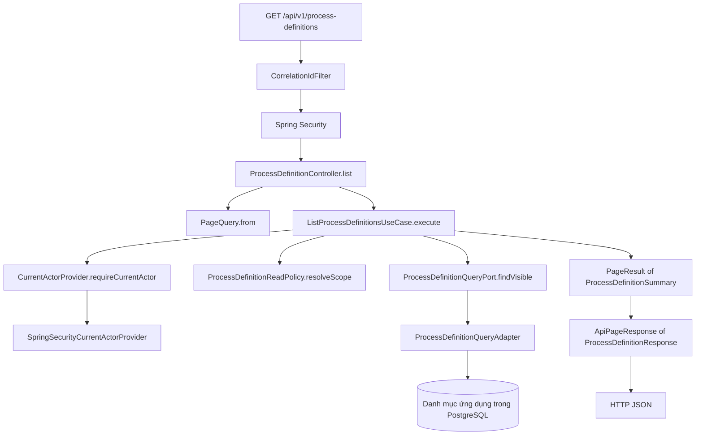

# P1.3 — Hướng dẫn tự triển khai module và hợp đồng API nền

## 1. Cách dùng bộ khung này

Bạn tự viết implementation nghiệp vụ theo các `// TODO:`. Theo yêu cầu mới,
security, CORS, global exception handler, base response, Clock và correlation đã
được triển khai/kích hoạt. Xem [phần nền đã xử lý](P1.3-API-Foundation.md).
**Cập nhật ngày 02/11/2026:** Các helper phân trang/revision, ActorContext, mapper,
policy, use case và body controller/config của P1.3 đã có implementation và test
source. Tài liệu dưới đây vẫn giải thích cách xây từng phần để bạn đọc code.
Chưa chạy build/test; chưa đánh dấu P1.3 đạt. TODO runtime còn lại thuộc adapter
danh tính/persistence và việc kích hoạt module khi đủ dependency.

Các method concrete chưa triển khai chủ động ném `UnsupportedOperationException`.
Đây là dấu chỗ cần viết, không phải kết quả nghiệp vụ. Không đổi chúng thành
`return null`, danh sách rỗng hoặc `true` chỉ để ứng dụng chạy được.

Các record khai báo sẵn trường; enum khai báo giá trị; constructor có phần gán
dependency/dữ liệu tối thiểu. Các phần này giúp nhìn rõ hợp đồng. Constructor bảo vệ
invariant, mapping, policy và query của phần còn TODO vẫn là việc bạn viết;
nền HTTP/logging đã được triển khai theo tài liệu cập nhật.
Interface chỉ khai báo chữ ký; TODO của nó được thực hiện trong adapter.

Đọc theo thứ tự:

1. Mục 2–4 để hiểu ranh giới và luồng gọi.
2. Mục 5–6 rồi code các kiểu Java thuần và mapping.
3. Mục 7–8 để hiểu và sử dụng nền lỗi/security/correlation đã được triển khai.
4. Mục 9 để thực hành lát cắt mẫu, giữ các adapter chưa có đầu vào ở dạng khung.
5. Mục 10–11 để tự kiểm tra, ghi nhận kết quả và commit đúng trạng thái.

Nguồn phạm vi: P1.3 trong `Enterprise-BPM-Implementation-Plan.md`; kiến trúc và API
ở mục 7, 10 của `Enterprise-BPM-MVP-Specification.md`. Giữ nguyên phiên bản trong
pom, Docker hiện có và quyết định chưa dùng migration.

## 2. Mỗi module sở hữu phần nào?

Mỗi package nghiệp vụ đã có `package-info.java`. File này là tài liệu của package,
không phải Spring bean. Đọc file trước khi thêm class vào module tương ứng.

| Package | Sở hữu | Không đặt vào module này | Thời điểm code nghiệp vụ |
| --- | --- | --- | --- |
| `identity` | Tài khoản, JWT, trạng thái ACTIVE, quyền và danh tính người gọi | Quy tắc ai được duyệt một task cụ thể | P2.1–P2.3 |
| `organization` | Cây phòng ban, thành viên, phòng ban chính, trưởng phòng | Tự đổi người đang giữ task khi đổi tổ chức | P2.2 |
| `process` | Danh mục, draft/version, publish, mapping engine | Dữ liệu form đã điền của từng hồ sơ | P1.5, Phase 4 |
| `form` | Schema/UI schema, version, validation và quyền trường | Tự chuyển bước workflow | Phase 3 |
| `businessrecord` | Hồ sơ, requester, dữ liệu đã điền, revision, version ghim | Engine/state machine thứ hai | Phase 5 |
| `task` | Inbox, queue/claim, complete, assignment và ngoại lệ | API trả object Task của Flowable | P1.5, P2.4, Phase 5 |
| `notification` | Thông báo trong ứng dụng, người nhận, đã đọc | Email/push ngoài phạm vi MVP | P6.6 |
| `audit` | Lịch sử hành động nghiệp vụ theo quyền | Dùng application log thay audit hoặc lưu bí mật | Theo từng use case cần audit |
| `shared` | Lỗi, paging, revision helper, Clock, correlation/logging | Luật mua sắm, entity chung hoặc BaseService tổng quát | P1.3 |

Chưa tạo CRUD/controller/service/entity rỗng ở tất cả module: mỗi class cần có một
use case cụ thể để phục vụ. Với `organization`, `form`, `businessrecord`, `task`,
`notification`, `audit`, đầu ra hiện tại là ranh giới trong `package-info.java`.
Lát cắt `process` bên dưới là mẫu để bạn áp dụng khi đến bước tương ứng.

## 3. Code map — các file đã tạo

Gốc cây: `src/main/java/com/x/bpm`. `BpmApplication.java` có sẵn, không sửa.

```text
com/x/bpm/
├── audit/package-info.java
├── businessrecord/package-info.java
├── form/package-info.java
├── organization/package-info.java
├── notification/package-info.java
├── task/package-info.java
├── identity/
│   ├── package-info.java
│   ├── domain/ActorContext.java
│   ├── application/
│   │   ├── CurrentActorProvider.java
│   │   ├── AccessTokenIssuer.java
│   │   └── IssuedAccessToken.java
│   ├── config/
│   │   ├── ApiCorsProperties.java
│   │   ├── JwtSecurityProperties.java
│   │   ├── JwtSecurityConfiguration.java
│   │   └── SecurityConfiguration.java
│   └── adapter/security/
│       ├── ApiSecurityHandlers.java
│       ├── NimbusAccessTokenIssuer.java
│       └── SpringSecurityCurrentActorProvider.java
├── process/
│   ├── package-info.java
│   ├── domain/
│   │   ├── ProcessCatalogScope.java
│   │   └── ProcessDefinitionReadPolicy.java
│   ├── application/
│   │   ├── ProcessDefinitionSummary.java
│   │   ├── ProcessDefinitionQueryPort.java
│   │   └── ListProcessDefinitionsUseCase.java
│   ├── api/
│   │   ├── ProcessDefinitionResponse.java
│   │   └── ProcessDefinitionController.java
│   ├── adapter/persistence/ProcessDefinitionQueryAdapter.java
│   └── config/ProcessModuleConfiguration.java
└── shared/
    ├── package-info.java
    ├── application/
    │   ├── PageQuery.java
    │   ├── PageResult.java
    │   └── RevisionGuard.java
    ├── error/
    │   ├── ErrorCode.java
    │   ├── ValidationIssue.java
    │   └── ApplicationException.java
    ├── api/
    │   ├── ApiPageResponse.java
    │   ├── ApiResponse.java
    │   ├── ApiResponseFactory.java
    │   ├── ApiResponseWriter.java
    │   ├── ApiErrorMapping.java
    │   ├── ApiErrorController.java
    │   └── ApiExceptionHandler.java
    ├── adapter/web/CorrelationIdFilter.java
    └── config/ApiFoundationConfiguration.java
```

Các thư mục lớp con có nghĩa như sau:

| Thư mục | Nhận gì? | Làm gì? | Được phụ thuộc gì? |
| --- | --- | --- | --- |
| `api` | HTTP/request DTO | Parse, chuyển DTO, gọi use case, tạo response | Application và kiểu dữ liệu công khai |
| `application` | Query/command Java thuần | Lấy actor, gọi policy và port, điều phối use case | Domain, cổng của mình, hợp đồng công khai module khác |
| `domain` | Dữ liệu Java thuần | Quy tắc và quyết định nghiệp vụ | Java và kiểu dữ liệu công khai ổn định; không Spring/JPA/Flowable |
| `adapter` | Hợp đồng port | Nối DB/security/engine và chuyển đổi dữ liệu | Port, domain, thư viện hạ tầng |
| `config` | Các dependency đã hiện thực | Tạo bean và nối implementation vào port | Các lớp cần lắp ghép |

Không bắt domain import controller, repository JPA hoặc adapter. Không import entity
nội bộ của module khác. `ActorContext` là hợp đồng công khai của `identity`, vì vậy
policy của `process` có thể nhận nó. Cổng dữ liệu được đặt bên application sử dụng
nó; adapter hiện thực cổng, không để application `new` adapter.

Các kiểu trong `shared.error` là hợp đồng Java thuần trung lập để domain policy và
application cùng dùng; chúng không phụ thuộc HTTP. Chỉ `shared.api` ánh xạ mã lỗi
sang HTTP status. Nhờ vậy domain không phải import tầng API/application để báo lỗi.

## 4. Luồng gọi mẫu



Đây là luồng đích để học, **chưa phải endpoint process đã chạy**. Filter/handler đã
được triển khai; truy vấn danh mục thật và principal nghiệp vụ cần các bước sau.

Controller không cần biết người gọi là Admin hay nhân viên. Use case hỏi identity
để lấy actor, hỏi policy để lấy phạm vi rồi truyền phạm vi vào query port. Adapter
áp dụng phạm vi ngay trong truy vấn. Cả nội dung trang và tổng số dòng đều phải đã
lọc quyền; không lấy một trang tất cả dữ liệu rồi mới lọc trong Java.

## 5. Các quy ước cần dùng khi bạn code

Đây là lựa chọn kỹ thuật cho khung học P1.3, không phải các tính năng đã triển khai.

| Chủ đề | Quy ước |
| --- | --- |
| URL | `/api/v1`, tên tài nguyên số nhiều; ví dụ `/process-definitions` |
| ID | Dùng `String` opaque ở hợp đồng hiện tại; chưa ép kiểu lưu DB thành UUID; application ID khác engine ID |
| Response đơn | DTO đặt trong `ApiResponse.data`, metadata thành công/lỗi chung |
| Response danh sách | `ApiResponse.data` chứa `items`, `page`, `size`, `totalElements`, `totalPages` |
| Phân trang | Page bắt đầu từ 0; mặc định page 0, size 20; size trong 1..100; giới hạn hiện tại tập trung ở PageQuery |
| Sort | Một biểu thức `field,asc` hoặc `field,desc`; mặc định `updatedAt,desc` |
| Allowlist sort mẫu | `key`, `name`, `updatedAt`; thêm `id` làm tie-breaker phía adapter |
| Lỗi | ErrorCode ổn định, safe message, correlation ID, chi tiết field/element khi cần |
| Revision | `long` không âm; response có revision; request sửa sau này dùng expected revision; chưa thêm ETag đồng thời |
| Thời điểm | `Instant` trên DTO, JSON ISO 8601 UTC với `Z`; lấy now qua Clock |
| Ngày không có giờ | `LocalDate`, ví dụ ngày bắt đầu nghỉ; không đổi sang Instant lúc nửa đêm |
| Hiển thị giờ | UI hiển thị UTC+7 theo C-11; không đổi timezone toàn server để phục vụ UI |
| Correlation | Header `X-Correlation-ID`; 1..64 ký tự ASCII chữ/số/dấu `.`, `_`, `-`; thiếu/sai thì server sinh UUID |
| Log | Method, URI không query, thời gian xử lý, kết quả/status khi xác định được, correlation ID |
| Danh tính | Lấy từ principal đã xác minh; không nhận actorId/role/quyền từ request DTO |

Giới hạn 100 hiện là baseline trong mã khung. Trước khi cần cấu hình theo môi
trường, đưa nó ra một nguồn cấu hình và truyền giá trị vào validation, tránh để
hardcode và config cùng tồn tại với hai giá trị khác nhau.

Ví dụ payload phân trang đặt trong `ApiResponse.data` sau khi bạn hoàn thiện và có dữ liệu thật:

```http
GET /api/v1/process-definitions?page=0&size=20&sort=updatedAt,desc
X-Correlation-ID: manual-p13-001
```

```json
{
  "items": [
    {
      "id": "process-demo-001",
      "key": "purchase",
      "name": "Đề nghị mua sắm",
      "revision": 3,
      "updatedAt": "2026-11-01T03:00:00Z"
    }
  ],
  "page": 0,
  "size": 20,
  "totalElements": 1,
  "totalPages": 1
}
```

ID và dữ liệu trên chỉ minh họa hình dạng JSON, không được thêm vào adapter như
kết quả hardcode. API không chứa XML, entity JPA, password hoặc object Flowable.

## 6. Nhóm việc đầu tiên — kiểu dữ liệu Java thuần và mapping

### 6.1. PageQuery.java

Mục đích: thống nhất đầu vào phân trang để use case không phụ thuộc Spring Data.

Các hàm bạn viết:

```java
public static PageQuery from(Integer page, Integer size, String sort);
public long offset();
```

`Integer` cho phép biểu diễn tham số chưa gửi bằng `null`. Chỉ áp dụng mặc định khi
thiếu; `size=0` hoặc `sort=` là đầu vào sai, không âm thầm sửa thành mặc định.

Thứ tự code:

1. Thêm compact constructor `public PageQuery { ... }` để giữ invariant kể cả khi
   code khác gọi `new PageQuery(...)` trực tiếp.
2. Kiểm tra page không âm, size 1..100 và cú pháp sort gồm đúng field/direction.
3. Với sort, thống nhất quy tắc `asc/desc`; không chấp nhận chuỗi SQL tự do.
4. Viết `from` áp dụng mặc định rồi gọi constructor.
5. Viết `offset` với phép nhân long ngay từ đầu.

Sai cấu trúc/range -> `ApplicationException(INVALID_REQUEST, safeMessage, details)`.
Implementation bỏ khoảng trắng hai đầu sort, nhận asc/desc không phân biệt hoa
thường và chuẩn hóa direction về chữ thường; tên trường vẫn giữ nguyên.
Allowlist trường cụ thể được kiểm tra tại query adapter của use case. Helper paging
không cần biết quy trình có thuộc tính `name` hay `updatedAt`.

### 6.2. PageResult.java

Mục đích: kết quả phân trang ở application, độc lập HTTP và Spring Data.

`items` là dữ liệu của một trang; `totalElements` là toàn bộ số dòng hợp lệ trong
cùng phạm vi/filter. Trang ngoài phạm vi có thể có items rỗng nhưng totalElements
vẫn lớn hơn 0. Đừng tính tổng bằng `items.size()`.

Bạn thêm compact constructor kiểm tra dữ liệu và dùng defensive copy cho list.
Viết `totalPages()` theo chia nguyên và phần dư để tránh overflow. Kết quả cần có:

| Tổng dòng | Size | Tổng trang |
| --- | --- | --- |
| 0 | 20 | 0 |
| 1 | 20 | 1 |
| 20 | 20 | 1 |
| 21 | 20 | 2 |

### 6.3. ApiPageResponse.java

Mục đích: chuyển PageResult sang hợp đồng HTTP mà không trộn mapping item vào
generic class. Hàm nhận hai tham số:

```java
public static <S, T> ApiPageResponse<T> from(
    PageResult<S> result, Function<S, T> itemMapper);
```

`S` là kiểu kết quả application, `T` là kiểu DTO trả HTTP. Mapper chung đã được
triển khai; nó lấy metadata từ PageResult và map từng item. Khi dùng với process, mapper là
`ProcessDefinitionResponse::from`. Không bắt lỗi mapper để bỏ qua item bị lỗi.

### 6.4. RevisionGuard.java

Mục đích: dùng chung cách báo lỗi revision cũ, không tự thực hiện cập nhật.

```java
public static void requireMatch(long expectedRevision, long actualRevision);
```

Expected revision âm từ client dùng INVALID_REQUEST; actual revision âm là lỗi
trạng thái nội bộ. So sánh expected/actual rồi ném `REVISION_CONFLICT` khi khác.
Nếu bằng nhau thì hàm kết thúc bình thường. Không tăng revision trong helper này.

Ví dụ: client đọc revision 4, DB đã là 5, request sửa với expected 4 -> 409. Nhưng
nếu hai request cùng đọc 4, phép so sánh Java đều có thể qua. Persistence vẫn cần
`@Version` hoặc cập nhật có điều kiện trong transaction. Kiểm chứng cạnh tranh thật
thuộc P1.6/các use case sau; helper này chưa chứng minh chống ghi đè.

## 7. Lỗi thống nhất — đã được triển khai theo yêu cầu mới

Các file ErrorCode, ValidationIssue, ApplicationException và global handler đã
được triển khai, cùng ApiResponse thay cho khung ApiErrorResponse cũ.
Không cần tự điền lại các phần này.

Xem [tài liệu nền HTTP, mục 2–3 và 7](P1.3-API-Foundation.md) để biết vai trò từng
file, cách tạo success/error, mã HTTP, validation và xử lý optimistic locking.
Khi tự viết use case, ném ApplicationException với mã phù hợp và message an toàn;
khi viết controller, inject ApiResponseFactory để bọc DTO một lần.

## 8. Security, CORS, Clock và correlation — đã được triển khai

ApiFoundationConfiguration, CorrelationIdFilter, SecurityConfiguration,
ApiSecurityHandlers, JWT encoder/decoder và AccessTokenIssuer đã là bean thực tế. Các annotation
cần thiết của phần nền đã được bật. Global handler và fallback servlet error cũng
được kích hoạt; controller/use case process vẫn chưa bật.

Xem [tài liệu nền HTTP, mục 4–8](P1.3-API-Foundation.md) để cấu hình origin, gửi
Bearer JWT, hiểu trạng thái chưa có login nghiệp vụ và chạy các kiểm tra.
Không thêm @Component lần nữa cho CorrelationIdFilter vì filter đã được đăng ký
bằng FilterRegistrationBean. CSRF đã tắt theo cơ chế JWT chỉ nhận qua Authorization,
không nhận token qua cookie. Không thêm lại session để thử controller.

## 9. Nhóm việc thứ tư — tự nối lát cắt process

### 9.1. Identity: ba file phối hợp ra sao?

| File | Bạn cần hiểu/viết |
| --- | --- |
| `ActorContext.java` | userId + active + tập quyền tin cậy; thêm constructor kiểm tra và copy Set |
| `CurrentActorProvider.java` | Interface `requireCurrentActor()`; application chỉ phụ thuộc interface này |
| `SpringSecurityCurrentActorProvider.java` | Implementation đọc security context và map principal ứng dụng; TODO để nối P2.1 |

Boot default user hiện đã bị tắt trong cấu hình nền; chưa có tài khoản đăng nhập
nghiệp vụ. Không map username thẳng thành application user ID. Không
trả ActorContext Admin cứng để controller mẫu chạy. Khi chưa có principal nghiệp
vụ, giữ adapter chưa là bean; nếu cần thực hành use case độc lập, dùng test double
chỉ trong test do bạn tự viết, không đăng ký vào runtime.

### 9.2. ProcessCatalogScope và ProcessDefinitionReadPolicy

Policy nhận ActorContext, trả phạm vi hoặc ném lỗi. Đầu vào không phải HttpServletRequest.

```java
public ProcessCatalogScope resolveScope(ActorContext actor);
```

| Tình huống | Kết quả cần có |
| --- | --- |
| Không có danh tính hợp lệ/inactive | UNAUTHENTICATED |
| Admin được quản trị danh mục | ALL |
| Người được xem danh mục để khởi tạo | STARTABLE_FOR_ACTOR |
| Không có quyền phù hợp | FORBIDDEN |

Tên permission cụ thể còn nối với P2.3. Không đưa một chuỗi quyền tạm vào runtime
rồi coi đó là policy đã được kiểm chứng. Phạm vi STARTABLE_FOR_ACTOR còn cần
adapter kiểm tra version có thể start và phạm vi người gọi thực tế.

Implementation bài thực hành hiện giữ các giá trị permission do người dùng viết:
`Admin` -> ALL, `SubAdmin` -> STARTABLE_FOR_ACTOR. Đây là chuỗi trong permissions
đã được identity cung cấp, không đọc role/header do client tự khai. Actor null hoặc
inactive ném UNAUTHENTICATED; actor thiếu quyền ném FORBIDDEN. Enum scope chỉ chứa
hai phạm vi truy vấn, không chứa mã lỗi. Test kiểm tra query port chưa bị gọi khi
policy từ chối.

### 9.3. ProcessDefinitionSummary và ProcessDefinitionQueryPort

Summary là mô hình đọc Java thuần, gồm id/key/name/revision/updatedAt. Đây chưa là
entity và không tạo bảng. Revision trong ví dụ là revision danh mục ứng dụng;
không lấy số version BPMN engine để thay nó. Draft revision sau này là khái niệm
riêng cho API lưu/publish draft.

Port là interface với chữ ký:

```java
PageResult<ProcessDefinitionSummary> findVisible(
    ActorContext actor, ProcessCatalogScope scope, PageQuery pageQuery);
```

Port không nhận Pageable của Spring Data, không trả JPA entity hoặc object engine.
Implementation có thể dùng các kiểu đó bên trong adapter rồi chuyển đổi khi trả ra.

### 9.4. ListProcessDefinitionsUseCase

Constructor đã chỉ rõ ba dependency: CurrentActorProvider, read policy và query
port. `execute(PageQuery)` cần điều phối theo thứ tự:

```text
actor = hỏi CurrentActorProvider về người gọi
scope = hỏi read policy về phạm vi của actor
result = hỏi query port với actor, scope và pageQuery
trả result
```

Bạn tự chuyển các dòng trên thành Java. Không bắt mọi exception rồi trả page rỗng;
page rỗng hợp lệ chỉ do query không tìm thấy dòng thuộc phạm vi.

### 9.5. ProcessDefinitionQueryAdapter

Đây là vị trí sau này inject repository/query component. Trong P1.3 chưa tạo
repository hoặc thêm bảng danh mục để phục vụ ví dụ.

Khi đã có schema và quyền thật, implementation cần:

1. Kiểm tra sort với allowlist, map sang thuộc tính DB, không nối thẳng chuỗi SQL.
2. Tạo điều kiện scope/actor và điều kiện version startable khi cần.
3. Đếm tổng với cùng điều kiện; phân trang và sort ổn định, thêm id làm tie-breaker.
4. Map dữ liệu DB sang ProcessDefinitionSummary và PageResult.

Không gọi Flowable để giả làm danh mục ứng dụng. Adapter engine sẽ được dựng riêng
ở P1.5 theo nhu cầu deploy/start/query/complete/history.

### 9.6. ProcessDefinitionResponse và ProcessDefinitionController

`ProcessDefinitionResponse.from(summary)` map từng trường sang HTTP DTO. Hai record
có thể giống trường hiện tại nhưng trách nhiệm khác nhau: sửa API sau này không
bắt use case phải biết JSON/annotation web.

Controller có hàm:

```java
public ApiResponse<ApiPageResponse<ProcessDefinitionResponse>> list(
    Integer page, Integer size, String sort, HttpServletRequest request);
```

Inject thêm ApiResponseFactory để bọc payload phân trang vào response chung một lần.
Chỉ cần chuyển request sang PageQuery, gọi use case, map kết quả. Method không
nhận actorId, scope hoặc role từ client. Không gọi security context, repository
hay engine ngay trong controller.

Các annotation route và @RequestParam đã được mô tả trong TODO. Giữ chúng ở dạng
comment khi dependencies còn thiếu. Việc đọc/viết policy Java thuần có thể thực
hành trước; bật endpoint thật phải đợi schema/principal/quyền tương ứng.

### 9.7. ProcessModuleConfiguration

Hai method factory đã tạo policy và use case bằng constructor injection. Chưa
đăng ký adapter persistence hoặc identity chưa hoàn chỉnh. Controller sau này dùng
@RestController, không cần thêm một @Bean Controller đồng thời.

Không cần tạo interface UseCase kèm UseCaseImpl khi chỉ có một implementation.
Port xuất hiện ở đây vì use case cần che chi tiết security và persistence.

## 10. Bạn tự kiểm tra như thế nào?

### 10.1. Rà soát tĩnh trước

- Đọc các TODO theo từng nhóm; tìm TODO còn lại bằng IDE hoặc `rg -n 'TODO' src/main/java`.
- Kiểu domain/application không import Spring MVC, Spring Data, JPA hoặc Flowable.
- Không có entity/engine object trong DTO, không có role check trong controller.
- Không có bean mới gọi method TODO trong lúc khởi động.
- Không đánh dấu adapter/schema/principal chưa có là đã hoàn thiện.

### 10.2. Các ca kiểm tra bạn nên tự viết khi triển khai

Đây là expected result. Đã có test source nhưng chưa chạy:

- PaginationContractsTest: mặc định, input sai, tổng trang, biên lớn và immutable list.
- RevisionGuardTest: revision bằng/cũ, expected âm và actual âm.
- ListProcessDefinitionsUseCaseTest: scope hợp lệ, actor bị từ chối không query,
  lỗi authentication/hạ tầng không bị biến thành page rỗng.
- ProcessDefinitionControllerTest: parse query -> use case -> mapper -> metadata.
- ApiFoundationWebTests: thêm kiểm tra lỗi pagination trả HTTP 400 qua JWT/MVC thật.

| Phần | Đầu vào/thao tác | Mong đợi |
| --- | --- | --- |
| PageQuery | null/null/null | page 0, size 20, sort updatedAt,desc |
| PageQuery | page -1, size 0 hoặc 101, sort rỗng | INVALID_REQUEST |
| PageQuery | Gọi constructor trực tiếp với dữ liệu sai | Cũng bị chặn, không chỉ factory kiểm tra |
| Sort adapter | Tên trường ngoài allowlist | INVALID_REQUEST, không chạy truy vấn tùy ý |
| PageResult | Tổng 0/1/20/21, size 20 | Tổng trang lần lượt 0/1/1/2 |
| RevisionGuard | expected 4, actual 4 | Không lỗi, không thay revision |
| RevisionGuard | expected 4, actual 5 | REVISION_CONFLICT; khi map HTTP là 409 |
| Mapping | Summary hợp lệ | DTO đúng metadata; không thêm dữ liệu nội bộ |
| Correlation | Header hợp lệ | Response/body lỗi/log dùng cùng ID |
| Correlation | Thiếu/sai ký tự/quá dài | Sinh ID mới hợp lệ |
| MDC | Chain thành công hoặc ném exception | Cuối cùng vẫn dọn/khôi phục MDC |
| MVC errors | JSON sai, validation sai, method sai | 400, 422, 405 tương ứng; 405 giữ Allow |
| Unexpected error | Exception chứa thông tin nhạy cảm | Body 500 không lộ message gốc; log có ID |
| Identity/policy | Actor thiếu/inactive/không quyền | Từ chối; không fallback Admin/ALL |
| Scope query về sau | Hai actor có scope khác nhau | Cả items và totalElements chỉ tính dữ liệu hợp lệ |

### 10.3. Lệnh do bạn chạy

Sau khi đã code một nhóm và muốn kiểm tra build/start dev:

```powershell
docker compose up --build -d --wait --wait-timeout 180
docker compose ps
Invoke-RestMethod http://localhost:8080/actuator/health
```

Mong đợi build thành công, backend/PostgreSQL healthy và health UP. Build image hiện
bỏ qua test theo Dockerfile. Nếu chưa bật route mẫu, không dùng việc gọi route thất
bại để kết luận skeleton sai; route mẫu chưa phải đầu ra runtime của lần dựng khung.

Để chạy test cách ly bằng cấu hình hiện có:

```powershell
docker compose -p bpm-test -f compose.test.yaml up --build --abort-on-container-exit --exit-code-from tests
$testExitCode = $LASTEXITCODE
```

Mong đợi exit code 0. Lấy báo cáo trước khi xóa container:

```powershell
New-Item -ItemType Directory -Force target | Out-Null
docker compose -p bpm-test -f compose.test.yaml cp tests:/workspace/target/surefire-reports ./target/test-results
docker compose -p bpm-test -f compose.test.yaml down
$testExitCode
```

Smoke test có sẵn chỉ chứng minh app/Flowable khởi động trên PostgreSQL test. Khi
bạn chưa viết test cho helper/filter/policy, smoke test xanh không chứng minh các
TODO đã đúng. Không dùng DB dev để kiểm thử reset/locking.

## 11. Tiến độ và commit

**Trạng thái hiện tại:** nền HTTP/security và code hợp đồng P1.3 đã có implementation
và test source; đã sửa các điểm review. Chưa build/test. Không đánh dấu P1.3 đạt.

Sau khi rà soát và tự chạy kiểm tra phần nền, bạn nên commit trước khi tự điền tiếp implementation:

```text
feat: implement P1.3 module boundaries and API contracts
```

Sau mỗi nhóm implementation có ý nghĩa, ghi lại bạn đã code gì và đã chạy kiểm
tra nào trước khi commit. Nếu chưa chạy, ghi rõ chưa chạy. Chỉ chuyển P1.4 sau khi
phần nền P1.3 đã tự triển khai/kiểm tra và các phần để dành đúng phase được ghi rõ.
Endpoint mẫu chưa có persistence/principal thật vẫn ở dạng khung, không phải API
nghiệp vụ đã nghiệm thu.

Việc tiếp theo là tự chạy build/test và gửi kết quả để chốt kiểm chứng P1.3.
Các helper/mapper/policy/use case hiện không còn TODO implementation. Những TODO
trong identity/persistence adapter và annotation kích hoạt module được nối khi có
schema/tài khoản/quyền tương ứng, không thêm dữ liệu giả vào runtime để bỏ qua chúng.
